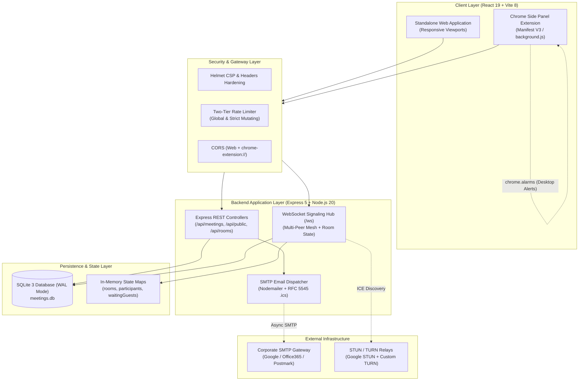
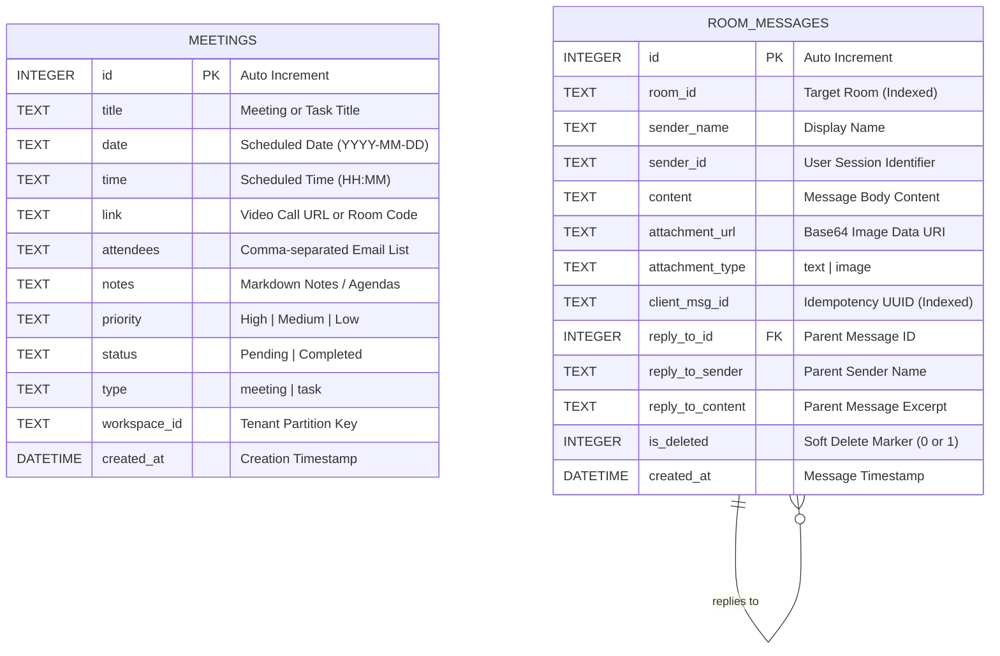
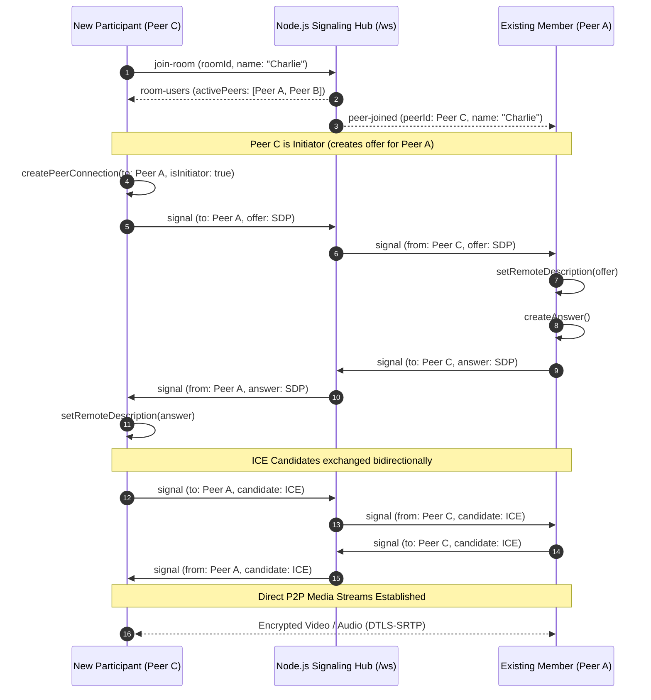
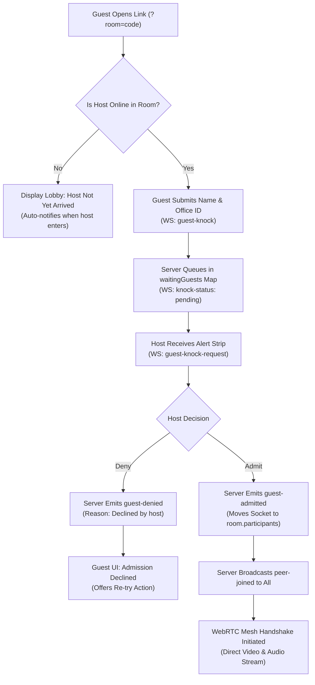
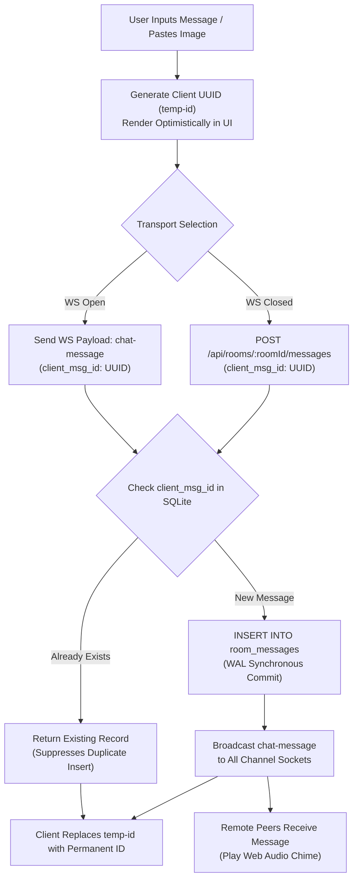
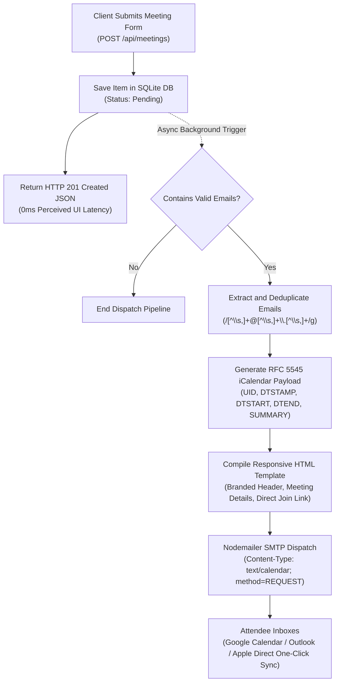
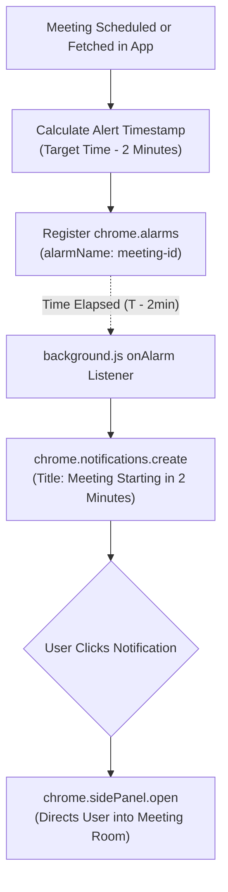
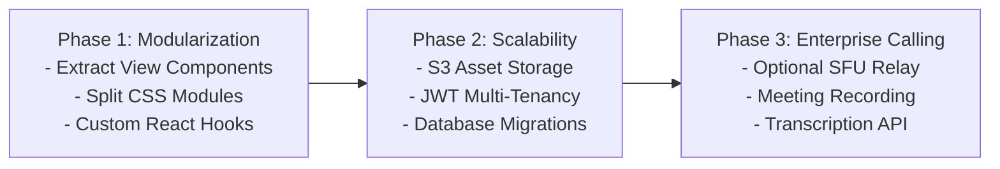

# PCS Meet Manager — System Architecture & Technical Documentation

* **Document Version:** 2.0.0
* **Status:** Active Production
* **Repository:** `meetManager`
* **Maintainer:** Executive Engineering Team

---

## Table of Contents (Index)

1. [Executive Summary & System Mission](#1-executive-summary--system-mission)
   - [1.1 Core Mission & Problem Statement](#11-core-mission--problem-statement)
   - [1.2 Target Personas & Use Cases](#12-target-personas--use-cases)
2. [High-Level Architecture & System Flowchart](#2-high-level-architecture--system-flowchart)
   - [2.1 Architectural Overview](#21-architectural-overview)
   - [2.2 System Architecture Flowchart](#22-system-architecture-flowchart)
   - [2.3 Dual-Runtime Client Deployment](#23-dual-runtime-client-deployment)
3. [Database Architecture & Entity-Relationship (ER) Diagram](#3-database-architecture--entity-relationship-er-diagram)
   - [3.1 Persistence Philosophy & SQLite WAL Mode](#31-persistence-philosophy--sqlite-wal-mode)
   - [3.2 Entity-Relationship (ER) Diagram](#32-entity-relationship-er-diagram)
   - [3.3 Schema DDL & Field Specifications](#33-schema-ddl--field-specifications)
   - [3.4 In-Memory State Models](#34-in-memory-state-models)
4. [WebRTC Multi-Peer Mesh Calling Engine](#4-webrtc-multi-peer-mesh-calling-engine)
   - [4.1 Multi-User Mesh Architecture](#41-multi-user-mesh-architecture)
   - [4.2 WebRTC Multi-Peer Signaling Sequence Diagram](#42-webrtc-multi-peer-signaling-sequence-diagram)
   - [4.3 Active Speaker Detection via Web Audio API](#43-active-speaker-detection-via-web-audio-api)
   - [4.4 Responsive Video Grids & Spotlight Filmstrip](#44-responsive-video-grids--spotlight-filmstrip)
   - [4.5 Picture-in-Picture (PiP) Multitasking](#45-picture-in-picture-pip-multitasking)
5. [Corporate Knocking Lobby & Gatekeeping Handshake](#5-corporate-knocking-lobby--gatekeeping-handshake)
   - [5.1 Two-Phase Admission Protocol](#51-two-phase-admission-protocol)
   - [5.2 Knocking Lobby Sequence & Flowchart](#52-knocking-lobby-sequence--flowchart)
   - [5.3 Bulk Admission (Admit All)](#53-bulk-admission-admit-all)
6. [Global Real-Time Work Chat & Asset Collaboration](#6-global-real-time-work-chat--asset-collaboration)
   - [6.1 Channel Subscription & Presence Protocol](#61-channel-subscription--presence-protocol)
   - [6.2 Message Pipeline & Idempotency Flowchart](#62-message-pipeline--idempotency-flowchart)
   - [6.3 Quoted Threading, Media Attachments & Soft Deletions](#63-quoted-threading-media-attachments--soft-deletions)
   - [6.4 Synthesized Web Audio Notification Chimes](#64-synthesized-web-audio-notification-chimes)
7. [Automated RFC 5545 Calendar Email Pipeline](#7-automated-rfc-5545-calendar-email-pipeline)
   - [7.1 Trigger & Attendee Extraction](#71-trigger--attendee-extraction)
   - [7.2 Calendar Email Dispatch Flowchart](#72-calendar-email-dispatch-flowchart)
   - [7.3 RFC 5545 iCalendar MIME Specification](#73-rfc-5545-icalendar-mime-specification)
8. [Chrome Extension Manifest V3 & Desktop Alarms](#8-chrome-extension-manifest-v3--desktop-alarms)
   - [8.1 Extension Architecture & Side Panel API](#81-extension-architecture--side-panel-api)
   - [8.2 Background Service Worker & Alarm Flowchart](#82-background-service-worker--alarm-flowchart)
   - [8.3 Contextual Tab Link Detection](#83-contextual-tab-link-detection)
   - [8.4 Automated Extension Packaging Pipeline](#84-automated-extension-packaging-pipeline)
9. [Executive Productivity Cockpit & Viewports](#9-executive-productivity-cockpit--viewports)
   - [9.1 Four Dedicated Viewports (Calendar, Table, Cards, Analytics)](#91-four-dedicated-viewports-calendar-table-cards-analytics)
   - [9.2 Executive Focus Modules (Standup, Pomodoro, Overdue Triage)](#92-executive-focus-modules-standup-pomodoro-overdue-triage)
10. [REST API Specification Reference](#10-rest-api-specification-reference)
11. [WebSocket Event Protocol Specification (`/ws`)](#11-websocket-event-protocol-specification-ws)
12. [Security, Hardening & Compliance Architecture](#12-security-hardening--compliance-architecture)
13. [Environment Configuration Reference](#13-environment-configuration-reference)
14. [Local Development, Docker & Deployment Guide](#14-local-development-docker--deployment-guide)
15. [Technical Debt & Strategic Roadmap](#15-technical-debt--strategic-roadmap)

---

## 1. Executive Summary & System Mission

### 1.1 Core Mission & Problem Statement
Modern professionals and distributed engineering teams experience high friction due to fragmented workplace software:

* **Video Conferencing Tools** (Google Meet, Zoom, Microsoft Teams) operate in separate browser tabs and require pre-generated links, authentication gates, and separate calendar invites.
* **Task Management Systems** (Linear, Jira, Todoist) are disconnected from active meeting discussions, resulting in lost action items and unassigned commitments.
* **Team Messaging** (Slack, Teams) is siloed from project calls, making asset sharing and live link distribution awkward.

**PCS Meet Manager** unifies these critical workflows into a single, high-speed cockpit. It functions interchangeably as a responsive web application and as a persistent Google Chrome Manifest V3 Side Panel (`chrome.sidePanel`), eliminating tab switching and enabling seamless multitasking.

```
┌────────────────────────────────────────────────────────────────────────┐
│                        PCS MEET MANAGER COCKPIT                        │
├───────────────────┬───────────────────┬────────────────────────────────┤
│  Video Calling    │  Productivity     │  Real-Time Collaboration       │
│  - WebRTC Mesh    │  - Calendar Grid  │  - Global Room Chat            │
│  - Active Speaker │  - Sprint Table   │  - Asset Sharing & Lightbox    │
│  - Knocking Lobby │  - Standup Gen    │  - Presence & Typing Indicators│
│  - Spotlight View │  - Pomodoro Focus │  - RFC 5545 .ics Calendar Email│
└───────────────────┴───────────────────┴────────────────────────────────┘
```

### 1.2 Target Personas & Use Cases

1. **Executive Leaders & Engineering Managers:**
   - Rapid morning review of calendar density, automated standup report generation for Slack/Teams, 25-minute Pomodoro sprint buffers, and overdue task triage.
2. **Distributed Agile Teams & Consultants:**
   - Ad-hoc zero-boundary video calls, friction-free client presentations via corporate knocking lobbies without guest registration, and markdown note-to-task parsing.
3. **Knowledge Workers & Developers:**
   - Operating via the Chrome Side Panel beside active code or document tabs, receiving 2-minute pre-meeting desktop alarms, and sharing screenshots directly from system clipboards.

---

## 2. High-Level Architecture & System Flowchart

### 2.1 Architectural Overview
The system is built as a **Modular Full-Stack Monolith with Dual-Runtime Client Deployment and Unified Real-Time Signaling**:

* **Client Runtime:** React 19 single-page application bundled with Vite 8. Adapts dynamically to standard browser viewports and constrained 400px Chrome Side Panel dimensions.
* **Server Runtime:** Node.js 20 with Express 5 handling REST routes, security policies (Helmet, Rate Limiting, CORS), and static asset delivery.
* **Signaling & Messaging Hub:** RFC 6455 compliant WebSocket server (`ws`) attached to the Node HTTP server, routing WebRTC peer signals, lobby knock handshakes, and chat messages.
* **Storage Engine:** Embedded SQLite 3 managed via `better-sqlite3` native C++ bindings in Write-Ahead Logging (`WAL`) mode.
* **Notification Subsystem:** Nodemailer SMTP transport generating RFC 5545 iCalendar (`.ics`) attachments for email calendar sync.

### 2.2 System Architecture Flowchart



### 2.3 Dual-Runtime Client Deployment
A single React 19 source code base (`client/src/App.jsx`) detects the host execution environment:

1. **Standard Browser Runtime (`window.chrome.sidePanel === undefined`):** Renders full executive viewports, wide calendar grids, and multi-tile video stages.
2. **Chrome Side Panel Runtime (`chrome-extension://` origin):** Dynamically applies `.chrome-panel-mode` CSS overrides, streamlining navigation into a vertical tab strip and preserving UI responsiveness in viewports as narrow as 360px.

---

## 3. Database Architecture & Entity-Relationship (ER) Diagram

### 3.1 Persistence Philosophy & SQLite WAL Mode
The application avoids external database dependencies (e.g., PostgreSQL or MySQL) to maximize deployment simplicity and execution speed:

* **Synchronous Native Execution:** `better-sqlite3` invokes SQLite C++ APIs directly, bypassing the Node.js libuv thread pool and avoiding microtask scheduling overhead.
* **Write-Ahead Logging (`WAL`):** Configured at startup via `db.pragma('journal_mode = WAL');`. Allows unlimited concurrent readers without blocking active write operations.
* **Persistent Pathing:** Configurable via the `DATABASE_PATH` environment variable, defaulting to `./server/meetings.db` or mounting cloud storage volumes (e.g., Docker volumes or Render persistent disks at `/data/meetings.db`).

### 3.2 Entity-Relationship (ER) Diagram



### 3.3 Schema DDL & Field Specifications

#### 1. Table: `meetings`
Stores scheduled meetings, action items, and executive tasks scoped by tenant workspace.

```sql
CREATE TABLE IF NOT EXISTS meetings (
  id INTEGER PRIMARY KEY AUTOINCREMENT,
  title TEXT NOT NULL,
  date TEXT NOT NULL,
  time TEXT NOT NULL,
  link TEXT,
  attendees TEXT,
  notes TEXT,
  priority TEXT DEFAULT 'Medium',
  status TEXT DEFAULT 'Pending',
  type TEXT DEFAULT 'task',
  workspace_id TEXT DEFAULT 'default',
  created_at DATETIME DEFAULT CURRENT_TIMESTAMP
);
```

* `id`: Unique surrogate integer primary key.
* `title`: Human-readable summary of the item.
* `date`: ISO 8601 calendar date (`YYYY-MM-DD`).
* `time`: 24-hour timestamp (`HH:MM`).
* `link`: Direct room code, internal link, or external video conferencing URL.
* `attendees`: Comma-separated email addresses parsed during meeting creation for automated RFC 5545 dispatch.
* `priority`: Categorization (`High`, `Medium`, `Low`) governing visual badge colors and calendar urgency ordering.
* `status`: Item state (`Pending`, `Completed`). Completed items automatically filter into the daily standup generator.
* `type`: Record discriminator (`meeting` vs. `task`).
* `workspace_id`: Tenant boundary identifier supplied via the `x-workspace-id` HTTP request header.

#### 2. Table: `room_messages`
Stores persistent channel and in-call chat histories, threaded replies, and image assets.

```sql
CREATE TABLE IF NOT EXISTS room_messages (
  id INTEGER PRIMARY KEY AUTOINCREMENT,
  room_id TEXT NOT NULL,
  sender_name TEXT NOT NULL,
  sender_id TEXT,
  content TEXT,
  attachment_url TEXT,
  attachment_type TEXT DEFAULT 'text',
  client_msg_id TEXT,
  reply_to_id INTEGER,
  reply_to_sender TEXT,
  reply_to_content TEXT,
  is_deleted INTEGER DEFAULT 0,
  created_at DATETIME DEFAULT CURRENT_TIMESTAMP
);

CREATE INDEX IF NOT EXISTS idx_room_messages_room ON room_messages(room_id);
CREATE INDEX IF NOT EXISTS idx_room_messages_client_id ON room_messages(client_msg_id);
```

* `room_id`: Channel namespace (e.g., `general`, `standup`, or active video call room codes). Indexed for sub-millisecond retrieval.
* `client_msg_id`: Client-generated UUID preventing duplicate message persistence during transient network reconnects.
* `reply_to_id`: Self-referential integer pointing to the parent message for quoted reply threading.
* `is_deleted`: Soft-delete flag (0 = active, 1 = deleted). Deleted messages display a placeholder without breaking reply hierarchy.

### 3.4 In-Memory State Models
Real-time WebRTC signaling and guest lobby queues are maintained in decoupled in-memory Maps on the Node.js server:

* `rooms`: `Map<roomId, RoomState>`
  - `host`: WebSocket instance of the registered meeting host.
  - `participants`: `Map<peerId, { ws, peerId, name, officeId, isHost, isAudioMuted, isVideoOff, isHandRaised }>`
  - `waitingGuests`: `Map<guestId, { id, name, officeId, ws, timestamp }>`
* `chatRooms`: `Map<roomId, Set<WebSocket>>`: Sockets subscribed to real-time chat broadcasts.

---

## 4. WebRTC Multi-Peer Mesh Calling Engine

### 4.1 Multi-User Mesh Architecture
The video conferencing subsystem utilizes a **Decentralized Multi-Peer WebRTC Mesh Network**:

* Every participant establishes direct, peer-to-peer DTLS-SRTP encrypted audio/video connections (`RTCPeerConnection`) with every other participant in the room.
* When a new peer joins, they receive a `room-users` roster of all current participants and initiate offers (`isInitiator = true`) to each existing peer.
* Existing peers receive a `peer-joined` notification and prepare their connection instances to receive incoming offers. This eliminates signaling glare and offer/answer collisions.

```
       [Peer A] <=====================> [Peer B]
          ▲                                ▲
          ║                                ║
          ║         P2P WebRTC Mesh        ║
          ║                                ║
          ▼                                ▼
       [Peer C] <=====================> [Peer D]
```

### 4.2 WebRTC Multi-Peer Signaling Sequence Diagram



### 4.3 Active Speaker Detection via Web Audio API
Real-time speaking status is detected entirely on the client using the browser's Web Audio API without server CPU overhead:

1. A master `AudioContext` initializes on call connection.
2. For the local media stream and every active remote stream, `createMediaStreamSource` connects to an `AnalyserNode` (`fftSize = 256`).
3. A `requestAnimationFrame` loop interrogates `getByteFrequencyData` across all analysers.
4. When average volume exceeds an amplitude threshold ($> 18$), the participant's `peerId` is flagged in the `speakingPeers` Set, activating a green speaker halo ring around their video tile.

### 4.4 Responsive Video Grids & Spotlight Filmstrip

* **Grid Mode:** Automatically applies dynamic CSS Grid classes based on the total participant count (`connectedPeers.length + 1`):
  - 1 User: `.grid-count-1` (Full-width focused tile)
  - 2 Users: `.grid-count-2` (Side-by-side 50/50 stage)
  - 3–4 Users: `.grid-count-4` (Balanced $2 \times 2$ grid)
  - 5–6 Users: `.grid-count-6` ($3 \times 2$ matrix)
  - 7–9 Users: `.grid-count-9` ($3 \times 3$ boardroom view)
  - 10+ Users: `.grid-count-many` (Auto-fitting responsive tiles)
* **Spotlight Mode:** Pinned speaker occupies a prominent hero canvas (`.meet-spotlight-hero`), while all other participants are arranged in a horizontal scrollable bottom filmstrip (`.meet-filmstrip`).

### 4.5 Picture-in-Picture (PiP) Multitasking
When the user minimizes the meeting window (`isCallMinimized = true`), the call switches into a docked Picture-in-Picture card in the lower corner of the screen. It renders the active speaker's video, a local thumbnail preview, and floating controls for mic mute, camera toggle, maximize, and call end.

---

## 5. Corporate Knocking Lobby & Gatekeeping Handshake

### 5.1 Two-Phase Admission Protocol
External participants joining via room links (`?room=<code>`) are isolated in a security gatekeeping lobby:

1. **Guest Identity Submission:** The guest provides their Full Name and Corporate Office ID before connecting.
2. **Host Review:** The host receives a doorbell chime and an admission prompt showing the guest's credentials.
3. **Decisive Action:** The host can admit or deny the guest. Upon admission, the server transfers the socket into active room participants and initiates ICE signaling.

### 5.2 Knocking Lobby Sequence & Flowchart



### 5.3 Bulk Admission (Admit All)
When multiple knocking guests are waiting concurrently in the lobby queue (`pendingKnocks.length > 1`), the host interface renders an **Admit All ({count})** button both in the floating alert banner and inside the People side panel tab. Clicking this button admits all queued attendees in a single batch.

---

## 6. Global Real-Time Work Chat & Asset Collaboration

### 6.1 Channel Subscription & Presence Protocol
* Sockets subscribe to channels via the `chat-join` event (`roomId: 'general'`, `'standup'`, or room codes).
* The server maintains connected client Sets in `chatRooms` and broadcasts live presence counts (`chat-presence`) whenever users join or disconnect.
* Sockets emit debounced `chat-typing` events while composing messages, displaying typing indicator bubbles to other channel members.

### 6.2 Message Pipeline & Idempotency Flowchart



### 6.3 Quoted Threading, Media Attachments & Soft Deletions
* **Quoted Replies:** Users can click reply on any message. The composer displays a quote preview banner, saving `reply_to_id`, `reply_to_sender`, and `reply_to_content` in the database.
* **Image Sharing:** Drag-and-drop or clipboard paste (`Ctrl+V`) triggers automatic conversion into a base64 data URI. Sockets broadcast the asset for immediate full-resolution display in an interactive modal lightbox.
* **Soft Deletions:** Senders can delete messages. The record's `is_deleted` column is updated to `1`, preserving thread structure while displaying a "This message was deleted" notice.

### 6.4 Synthesized Web Audio Notification Chimes
Incoming chat messages trigger `playChatNotificationSound()`, which uses the native Web Audio API to synthesize dual-tone sine-wave chimes (800 Hz and 1000 Hz) with exponential volume decay. This avoids external MP3/WAV asset dependencies and guarantees audible alerts across all client environments.

---

## 7. Automated RFC 5545 Calendar Email Pipeline

### 7.1 Trigger & Attendee Extraction
Whenever a meeting item is created via `POST /api/meetings`, the server checks whether `type === 'meeting'`, `sendEmailInvites === true`, and the `attendees` string contains valid email addresses. The server immediately returns an HTTP 201 response to keep the client UI instantaneous, then dispatches email invitations asynchronously in the background.

### 7.2 Calendar Email Dispatch Flowchart



### 7.3 RFC 5545 iCalendar MIME Specification
The generated `.ics` attachment adheres to the RFC 5545 specification with `METHOD:REQUEST`:

```
BEGIN:VCALENDAR
VERSION:2.0
PRODID:-//PCS Meet Manager//Executive Meeting//EN
CALSCALE:GREGORIAN
METHOD:REQUEST
BEGIN:VEVENT
UID:meet-1730985600000-xyz@meetmanager.pcs
DTSTAMP:20261106T070000Z
DTSTART:20261106T100000Z
DTEND:20261106T103000Z
SUMMARY:Executive Strategy Sync
DESCRIPTION:Agenda items and direct link: https://domain.com?room=strategy
LOCATION:PCS Virtual Room #strategy
STATUS:CONFIRMED
ORGANIZER;CN=Meeting Host:mailto:no-reply@meetmanager.pcs
ATTENDEE;CUTYPE=INDIVIDUAL;ROLE=REQ-PARTICIPANT;PARTSTAT=NEEDS-ACTION;RSVP=TRUE:mailto:colleague@company.com
END:VEVENT
END:VCALENDAR
```

---

## 8. Chrome Extension Manifest V3 & Desktop Alarms

### 8.1 Extension Architecture & Side Panel API
The Chrome extension is built under Google Chrome Manifest V3 specifications:

* **Side Panel Host:** Uses `chrome.sidePanel.setPanelBehavior({ openPanelOnActionClick: true })` to open the app directly inside the persistent browser sidebar.
* **Cross-Origin Access:** Requests host permissions (`"host_permissions": ["<all_urls>"]`) to inspect active tabs and detect meeting links.

### 8.2 Background Service Worker & Alarm Flowchart



### 8.3 Contextual Tab Link Detection
When creating an item in extension mode, the "Auto-Detect Call Link" action queries `chrome.tabs.query({ active: true, currentWindow: true })`. If the active tab is an active Google Meet, Zoom, or Teams call, the URL is automatically inserted into the meeting link input field.

### 8.4 Automated Extension Packaging Pipeline
The build script (`client/scripts/package-extension.js`) automates extension distribution:
1. Executes `vite build` to output production assets into `client/dist`.
2. Automatically generates compliant icons (`icon-16.png`, `icon-48.png`, `icon-128.png`).
3. Compresses `client/dist` into the distribution bundle: `pcs-meet-manager-extension.zip`.

---

## 9. Executive Productivity Cockpit & Viewports

### 9.1 Four Dedicated Viewports (Calendar, Table, Cards, Analytics)

| Viewport | Primary Purpose | Key Features |
| :--- | :--- | :--- |
| **Calendar View** | Temporal planning | 30-day interactive month grid with activity density indicators; 7-day executive sprint board. |
| **Table View** | High-density operational triage | Sortable columns (Date, Priority, Status, Title), inline status checkmarks, and one-click actions. |
| **Cards View** | Visual card overview | Kanban-style cards displaying priority tags, agenda previews, and external link shortcuts. |
| **Analytics View** | Executive metrics tracking | Completion rates, estimated weekly meeting hours, 90-day activity heatmap, and active streak counters. |

### 9.2 Executive Focus Modules (Standup, Pomodoro, Overdue Triage)

1. **Daily Standup Generator:** Parses all completed items from the last 24 hours, today's pending targets, and upcoming meetings, synthesizing a formatted Markdown standup report ready to copy into Slack or Teams.
2. **25-Minute Pomodoro Focus Sprint:** Visual countdown timer with progress ring, pause/resume controls, and audio notifications to manage focus intervals between meetings.
3. **Morning Overdue Triage:** Automatically detects past-due items and provides a one-click **Roll All to Today** bulk action.
4. **Notes-to-Tasks Converter:** Scans meeting agenda notes for Markdown checkbox bullet points (`- [ ]`, `*`) and batch-creates standalone task items in SQLite.

---

## 10. REST API Specification Reference

All endpoints are prefixed with `/api` and consume/produce `application/json`.

| Method | Endpoint | Rate Limit | Request Headers / Body | Success | Description |
| :--- | :--- | :--- | :--- | :---: | :--- |
| `GET` | `/api/health` | Standard | None | `200` | Returns server health and SQLite connection status. |
| `GET` | `/api/webrtc/ice-config` | Standard | None | `200` | Returns STUN/TURN server configurations and public URL. |
| `GET` | `/api/meetings` | Standard | `x-workspace-id: string` | `200` | Lists all meetings/tasks for the specified tenant workspace. |
| `POST` | `/api/meetings` | Strict | `x-workspace-id`, `{ title, date, time, link, attendees, notes, priority, status, type }` | `201` | Creates an item; triggers background RFC 5545 email invite if meeting. |
| `PUT` | `/api/meetings/:id` | Strict | `x-workspace-id`, `{ title, date, time, link, attendees, notes, priority, status }` | `200` | Updates an existing meeting/task scoped to the tenant workspace. |
| `DELETE` | `/api/meetings/:id` | Strict | `x-workspace-id: string` | `200` | Deletes an item scoped to the tenant workspace. |
| `GET` | `/api/public/live-meetings` | Standard | None | `200` | Public directory of today's scheduled meetings with active host/peer counts. |
| `GET` | `/api/public/room-status` | Standard | `?room=code` | `200` | Queries live host presence, participant count, and waiting queue length. |
| `GET` | `/api/rooms/:roomId/messages` | Standard | None | `200` | Fetches historical chat log (last 300 messages) for the specified room. |
| `POST` | `/api/rooms/:roomId/messages` | Standard | `{ senderName, senderId, content, attachmentUrl, clientMsgId, replyToId }` | `201` | Persists a chat message in SQLite and broadcasts it via WebSocket. |
| `DELETE` | `/api/rooms/:roomId/messages/:id`| Standard | None | `200` | Soft-deletes a message (`is_deleted = 1`) and broadcasts removal. |

---

## 11. WebSocket Event Protocol Specification (`/ws`)

The WebSocket endpoint operates at `/ws` over standard RFC 6455 protocols:

| Event Type | Direction | Payload Structure | Architectural Function |
| :--- | :---: | :--- | :--- |
| `host-join` | Client $\rightarrow$ Server | `{ type, roomId }` | Registers socket as meeting host; returns `host-ready` and pending lobby queue. |
| `join-room` | Client $\rightarrow$ Server | `{ type, roomId, name }` | Direct entry; returns `room-users` to joiner and broadcasts `peer-joined` to room. |
| `guest-knock` | Client $\rightarrow$ Server | `{ type, roomId, guest: { id, name, officeId } }` | Queues guest in waiting lobby; emits `guest-knock-request` to host socket. |
| `admit-guest` | Host $\rightarrow$ Server | `{ type, guestId }` | Admits guest; emits `guest-admitted` to guest and `peer-joined` to room. |
| `deny-guest` | Host $\rightarrow$ Server | `{ type, guestId, reason }` | Declines guest entry; emits `guest-denied` with dismissal reason. |
| `signal` | Bidirectional | `{ type, toPeerId, fromPeerId, payload }` | Relays WebRTC SDP Offer, SDP Answer, or ICE Candidate directly to target peer. |
| `peer-status` | Client $\rightarrow$ Server | `{ type, roomId, isAudioMuted, isVideoOff, isHandRaised }` | Broadcasts live mic, camera, or hand-raise state updates to all room peers. |
| `raise-hand` | Client $\rightarrow$ Server | `{ type, isRaised, senderName }` | Broadcasts hand-raise status notification across room participants. |
| `chat-join` | Client $\rightarrow$ Server | `{ type, roomId }` | Subscribes socket to room chat; broadcasts updated `chat-presence` count. |
| `chat-typing` | Client $\rightarrow$ Server | `{ type, roomId, senderName, isTyping }` | Relays ephemeral typing indicators to room subscribers. |
| `chat-message` | Bidirectional | `{ type, roomId, message: {...} }` | Persists message in SQLite and broadcasts to all room subscribers. |
| `chat-delete` | Bidirectional | `{ type, roomId, messageId }` | Sets soft-delete marker in SQLite and notifies connected room clients. |

---

## 12. Security, Hardening & Compliance Architecture

1. **Enterprise Header Hardening (`helmet`):**
   - Implements strict Content Security Policy (CSP) allowing inline scripts required by Vite HMR, Google Fonts stylesheets, WebRTC media streams (`blob:`), and secure WebSocket protocols (`ws:`, `wss:`).
   - Enforces `X-Frame-Options: SAMEORIGIN`, `X-Content-Type-Options: nosniff`, and `Cross-Origin-Opener-Policy`.
2. **Two-Tier Denial-of-Service (DDoS) Rate Limiting (`express-rate-limit`):**
   - **Global Tier:** 200 requests per 15 minutes per IP address across read-only endpoints.
   - **Mutating Tier:** 80 requests per 5 minutes per IP address for write operations (`POST`, `PUT`, `DELETE` on `/api/meetings`).
3. **Cross-Origin Resource Sharing (`cors`):**
   - Configured with open permissive reflection across web ports and Chrome Extension origins (`chrome-extension://*`), enabling the extension to communicate with the local or cloud backend.
4. **Zero-Trust Input Sanitization:**
   - Parameterized SQL queries via `better-sqlite3` prepared statements prevent SQL injection vulnerabilities.
   - Client messages and agenda inputs are length-constrained and type-verified before persistence.

---

## 13. Environment Configuration Reference

Create a `.env` file in the `server/` directory based on `server/.env.example`:

| Variable | Default Value | Description |
| :--- | :--- | :--- |
| `PORT` | `5000` | Port on which the Express and WebSocket server listens. |
| `DATABASE_PATH` | `./server/meetings.db` | File path for SQLite storage. Can be set to a persistent volume mount. |
| `PUBLIC_URL` | Auto-detected | Canonical public URL used in email invitations and guest links. |
| `SMTP_HOST` | `smtp.gmail.com` | Hostname of the outgoing SMTP mail transfer agent. |
| `SMTP_PORT` | `587` | Port for SMTP communication (587 for STARTTLS, 465 for SSL). |
| `SMTP_SECURE` | `false` | Set to `true` if connecting over port 465. |
| `SMTP_USER` | `""` | Username / email address for SMTP authentication. |
| `SMTP_PASS` | `""` | Password or application-specific password for SMTP authentication. |
| `SMTP_FROM` | `"PCS Meet Manager <no-reply@meetmanager.pcs>"` | Sender header for automated email invitations. |
| `TURN_SERVER_URL` | `""` | Optional TURN relay URL (e.g., `turn:turn.example.com:3478`). |
| `TURN_USERNAME` | `""` | Username for TURN server authentication. |
| `TURN_CREDENTIAL` | `""` | Credential/secret for TURN server authentication. |

---

## 14. Local Development, Docker & Deployment Guide

### 14.1 Local Development Setup

```bash
# 1. Clone the repository
git clone https://github.com/itssagarK/meetManager.git
cd meetManager

# 2. Install dependencies for all tiers
npm install
cd server && npm install && cd ..
cd client && npm install && cd ..

# 3. Start development servers
# Terminal 1: Backend API & WebSocket Server (Port 5000)
npm run server

# Terminal 2: Vite Client (Port 5173 with HMR)
npm run client
```

### 14.2 Instant Public Access via Tunnel
To test mobile devices or share meetings with external participants without deploying to the cloud:

```bash
# Expose port 5000 via secure public HTTPS tunnel
npm run tunnel
```

### 14.3 Multi-Stage Docker Container Deployment
The application includes a production-grade multi-stage `Dockerfile`:

```dockerfile
# Build Stage: Compile Vite frontend assets
FROM node:20-slim AS build
WORKDIR /app
COPY client/package*.json ./client/
RUN cd client && npm ci
COPY client/ ./client/
RUN cd client && npm run build

# Runtime Stage: Serve Express, WebSockets, and built SPA
FROM node:20-slim
WORKDIR /app
COPY server/package*.json ./server/
RUN cd server && npm ci --only=production
COPY server/ ./server/
COPY --from=build /app/client/dist ./client/dist
EXPOSE 5000
CMD ["node", "server/server.js"]
```

Build and run the container locally:

```bash
docker build -t pcs-meet-manager .
docker run -p 5000:5000 -v meet_data:/data -e DATABASE_PATH=/data/meetings.db pcs-meet-manager
```

---

## 15. Technical Debt & Strategic Roadmap

### 15.1 Architectural Observations
1. **Component Consolidation (`App.jsx`):** `client/src/App.jsx` serves as an all-in-one application orchestrator. While this ensures fast developer iteration and easy state sharing, modularizing it into dedicated view components will improve long-term maintainability.
2. **Stylesheet Scoping (`App.css`):** The stylesheet is comprehensive and highly unified. Transitioning toward CSS Modules will prevent global specificity conflicts as the team expands.
3. **WebRTC Mesh Scaling ($O(N^2)$):** The peer-to-peer mesh architecture is cost-effective, zero-server-load, and performs reliably for 2 to 4 participants. For larger meetings (8+ participants), integrating a Selective Forwarding Unit (SFU, such as LiveKit or Mediasoup) will optimize upstream bandwidth.

### 15.2 Recommended Engineering Roadmap



* **Phase 1 (Component Modularization):** Decompose `App.jsx` into dedicated modules (`/src/components/views`, `/src/components/webrtc`, `/src/components/chat`).
* **Phase 2 (Scalability & Asset Storage):** Offload large base64 chat attachments from SQLite to an S3-compatible bucket (AWS S3, Cloudflare R2), saving clean CDN URLs in the database.
* **Phase 3 (Enterprise Calling & Relays):** Implement an optional SFU gateway for large conference calls while preserving the lightweight direct P2P mesh for 1:1 and small team syncs.
