# 📑 PCS Meet Manager — Complete System Architecture & Documentation

<div align="center">

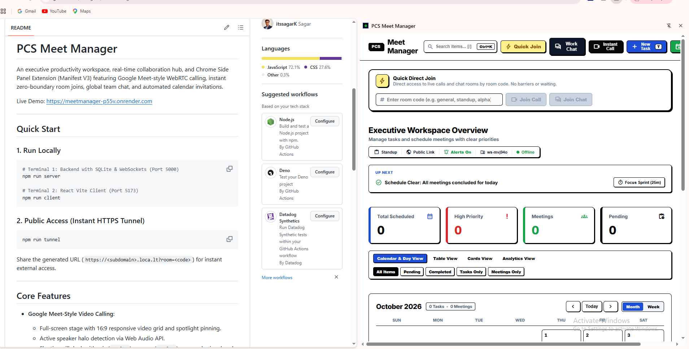

### **Executive Productivity Workspace • Zero-Boundary WebRTC Calling • Chrome Side Panel (MV3)**

[](https://meetmanager-p55v.onrender.com)
[](https://react.dev/)
[](https://nodejs.org/)
[-003B57.svg)](https://sqlite.org/)
[-010101.svg)](https://github.com/websockets/ws)
[](https://webrtc.org/)

**[🌐 Live Production Demo](https://meetmanager-p55v.onrender.com)** • **[🎓 Beginner's Study Guide](docs/STUDY_GUIDE.md)** • **[🚀 Quickstart Guide](#15-installation-local-development--deployment-guide)** • **[📊 API Reference](#11-complete-rest-api-specification-reference)** • **[🔌 WebSocket Events](#12-complete-websocket-event-protocol-specification-ws)**

</div>

---

## 🧭 Navigation Index

1. [Executive Summary & Problem Statement](#1-executive-summary--problem-statement)
2. [Visual Interface Gallery](#2-visual-interface-gallery)
3. [High-Level Architecture & System Flowchart](#3-high-level-architecture--system-flowchart)
4. [End-to-End System Working Analysis & Entity-Relationship (ER) Architecture](#4-end-to-end-system-working-analysis--entity-relationship-er-architecture)
5. [WebRTC Multi-Peer Mesh Calling Engine](#5-webrtc-multi-peer-mesh-calling-engine)
6. [Corporate Knocking Lobby & Gatekeeping Handshake](#6-corporate-knocking-lobby--gatekeeping-handshake)
7. [Global Real-Time Chat & Asset Collaboration](#7-global-real-time-chat--asset-collaboration)
8. [Automated RFC 5545 Calendar Email Pipeline](#8-automated-rfc-5545-calendar-email-pipeline)
9. [Chrome Extension Manifest V3 & Desktop Alarms](#9-chrome-extension-manifest-v3--desktop-alarms)
10. [Executive Productivity Cockpit & Viewports](#10-executive-productivity-cockpit--viewports)
11. [Complete REST API Specification Reference](#11-complete-rest-api-specification-reference)
12. [Complete WebSocket Event Protocol Specification (`/ws`)](#12-complete-websocket-event-protocol-specification-ws)
13. [Security, Hardening & Compliance Architecture](#13-security-hardening--compliance-architecture)
14. [Environment Configuration Reference](#14-environment-configuration-reference)
15. [Installation, Local Development & Deployment Guide](#15-installation-local-development--deployment-guide)
16. [Troubleshooting & Frequently Asked Questions (FAQ)](#16-troubleshooting--frequently-asked-questions-faq)
17. [Strategic Engineering Roadmap](#17-strategic-engineering-roadmap)

---

## 1. Executive Summary & Problem Statement

### 1.1 The Workplace Context: The "Tab-Switching Tax"
Modern knowledge workers, executives, and distributed software engineering teams suffer from acute workflow fragmentation. Completing a single working day typically requires juggling four or five disconnected applications:

* **Video Conferencing Tools** (Google Meet, Zoom, Teams): Operate in isolated browser tabs, require pre-generated links, authentication screens, and separate calendar invites.
* **Task Management Systems** (Linear, Jira, Todoist, Asana): Disconnected from active meetings; commitments and action items made during calls are frequently forgotten.
* **Team Messaging** (Slack, Microsoft Teams): Siloed from project agendas, making screenshot sharing and document coordination cumbersome.
* **Calendar Schedulers** (Google Calendar, Outlook): Inconvenient to check during active work sessions without leaving the current workspace.

### 1.2 The Solution: PCS Meet Manager
**PCS Meet Manager** unifies these critical workflows into a single, high-speed, zero-friction executive cockpit. It operates in two complementary modes:

1. **Standalone Responsive Web Application:** A full-featured web app running in any modern browser on desktop, tablet, or mobile.
2. **Persistent Chrome Manifest V3 Side Panel (`chrome.sidePanel`):** Docks directly into the browser viewport beside active code, pull requests, or documents, eliminating tab-switching entirely.

```
┌─────────────────────────────────────────────────────────────────────────────┐
│                          PCS MEET MANAGER COCKPIT                           │
├──────────────────────┬──────────────────────┬───────────────────────────────┤
│  Video Conferencing  │  Executive Cockpit   │  Real-Time Collaboration      │
│  • WebRTC P2P Mesh   │  • Month Calendar    │  • Global Online Chat Rooms   │
│  • Active Audio Halo │  • Sprint Table View │  • Threaded Quoted Replies    │
│  • Knocking Lobby    │  • Kanban Cards View │  • In-Line Image Lightbox     │
│  • Spotlight Mode    │  • Analytics Heatmap │  • Typing & Presence Counters │
│  • Picture-in-Picture│  • Daily Standup Gen │  • RFC 5545 .ics Calendar Sync│
└──────────────────────┴──────────────────────┴───────────────────────────────┘
```

> [!NOTE]
> **Zero-Boundary Philosophy**: Anyone can join a video meeting or public chat room using an instant room code (`?room=code`). No sign-up, registration, or password creation is required for guests.

---

## 2. Visual Interface Gallery

PCS Meet Manager features eight carefully designed interfaces tailored for desktop monitors and narrow Chrome Side Panel dimensions.

### 2.1 Video Conferencing & Security Gatekeeping

| WebRTC Multi-User Calling | Corporate Knocking Lobby |
| :---: | :---: |
| 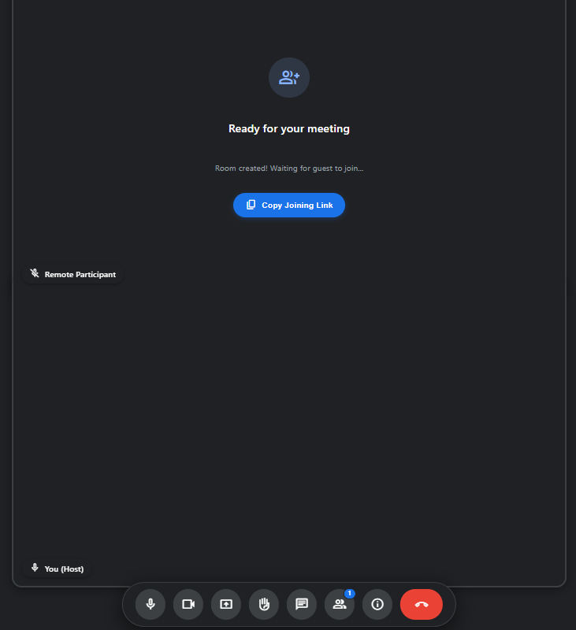 | 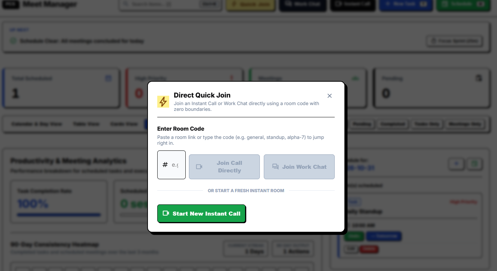 |
| *Multi-peer video calling with dynamic grids, active speaker halo, floating dock, and collapsible drawer.* | *Two-phase guest verification requiring Full Name & Office ID with host admit/deny controls.* |

### 2.2 Operational Viewports

| Month & Week Calendar View | Sprint Table View |
| :---: | :---: |
| 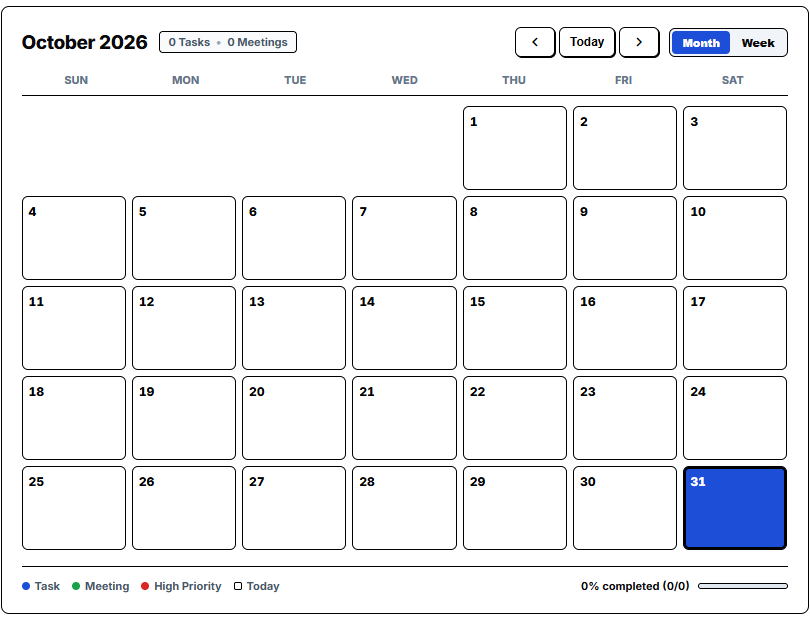 | 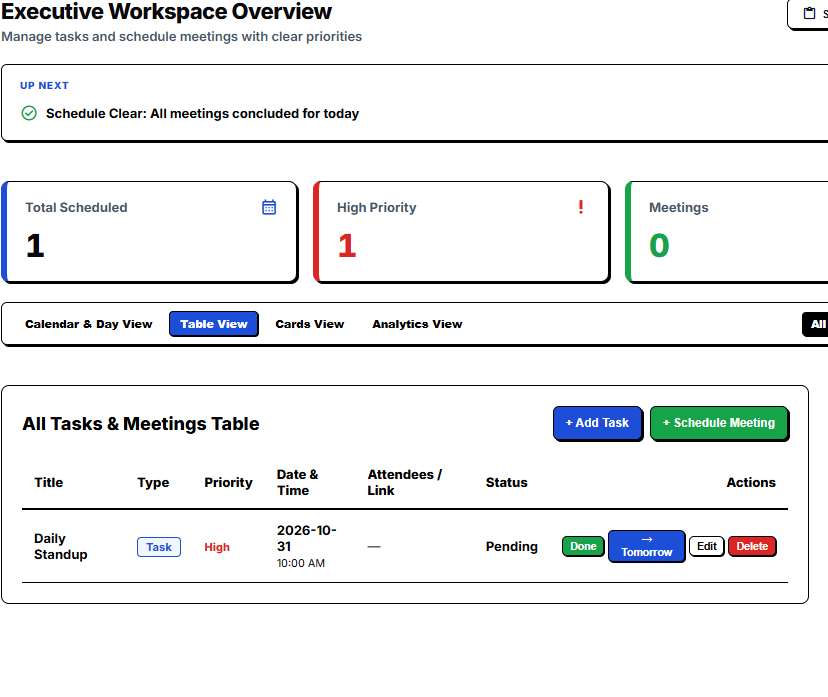 |
| *30-day interactive month grid with activity density indicators and 7-day executive sprint view.* | *High-density table with sortable columns, inline status toggling, and priority tags.* |

### 2.3 Collaboration & Metrics

| Global Real-Time Work Chat | Executive Analytics & Metrics |
| :---: | :---: |
| 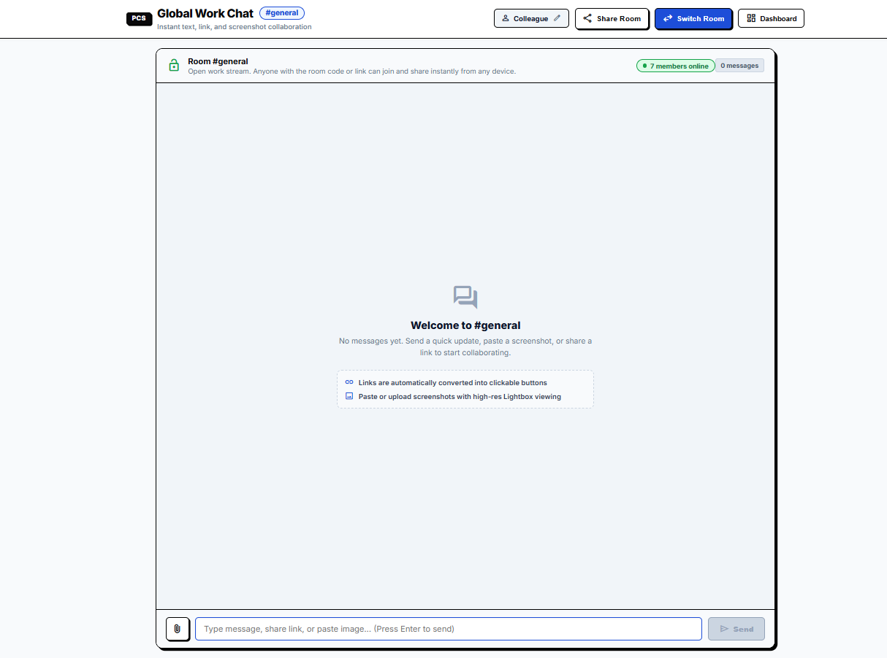 | 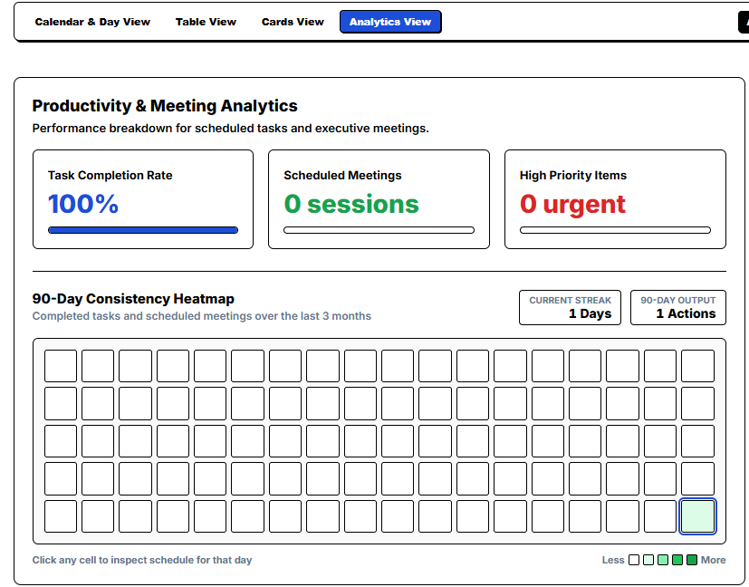 |
| *Instant messaging with live presence, typing bubbles, quoted replies, and image lightbox.* | *Completion rates, estimated weekly meeting hours, 90-day activity heatmap, and streak tracking.* |

### 2.4 Multitasking & Cards

| Chrome Side Panel (MV3) | Kanban Cards View |
| :---: | :---: |
|  | 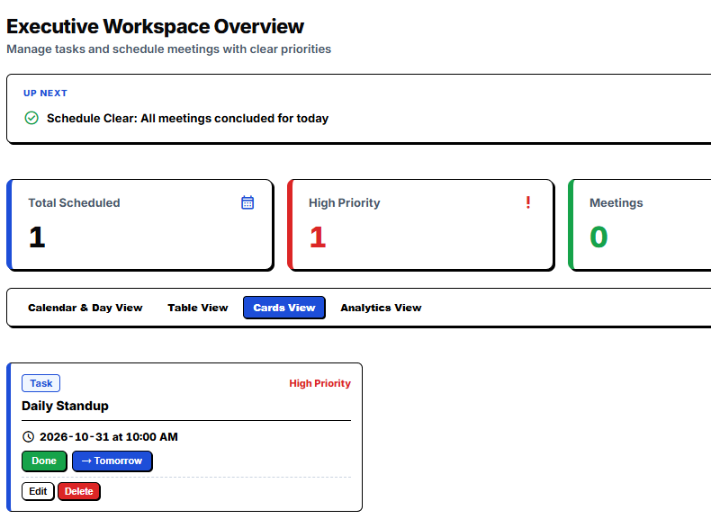 |
| *Persistent 400px side panel docked next to active browser tabs with auto-call detection.* | *Visual card overview with priority indicators, markdown notes, and one-click launch links.* |

---

## 3. High-Level Architecture & System Flowchart

The system is constructed as a **Modular Full-Stack Monolith with Dual-Runtime Client Deployment and Unified Real-Time Signaling**.

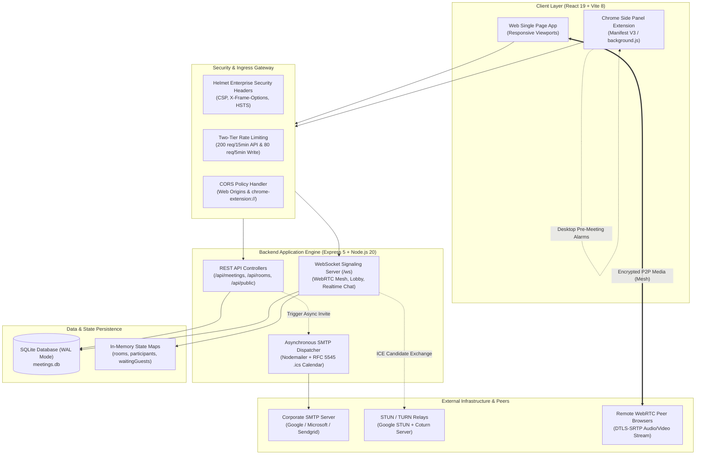

### 3.1 Architectural Pillars

1. **Dual-Runtime Client:** A single React 19 codebase dynamically detects whether it is running in a standard browser tab or inside Google Chrome's `chrome.sidePanel` via `window.location.protocol === 'chrome-extension:'`. It applies specialized CSS layouts for constrained widths (360px–420px).
2. **Local-First Optimistic UI:** Client-side updates occur at $0\text{ ms}$ perceived latency. State mutations are reflected immediately in the UI while synchronization takes place in the background.
3. **Synchronous C++ Database Execution:** Embedded SQLite powered by `better-sqlite3` runs directly against C++ SQLite APIs without the overhead of thread-pool context switches. Write-Ahead Logging (`WAL`) allows concurrent reads while writes take place.
4. **Zero-Dependency Real-Time Signaling:** Standard Node.js `ws` library handles WebSockets for WebRTC SDP signaling, room presence, chat events, and lobby admission over port 5000.

---

## 4. End-to-End System Working Analysis & Entity-Relationship (ER) Architecture

### 4.1 In-Depth Subsystem Working Analysis
To understand how data flows and how entities interact across PCS Meet Manager, the system can be decomposed into seven tightly integrated operational subsystems:

#### 1. Multi-Tenant Workspace Partitioning Engine
* **Isolation Scope:** Every schedule record and meeting item belongs to a specific tenant workspace, tracked by `workspace_id`.
* **Runtime Resolution:** The client detects or initializes a persistent workspace ID in `localStorage` (`mm_workspace_id`) and attaches it to all outbound HTTP requests via the `x-workspace-id` header.
* **Database Isolation:** SQLite queries strictly scope mutations and reads (`WHERE workspace_id = ?`), preventing data leaks between distinct client sessions, teams, or testing environments.

#### 2. Unified Schedule & Action Items Engine
* **Single-Table Design:** Rather than maintaining disparate tables for calendar events and to-do items, the `meetings` table unifies both concepts using the `type` column discriminator (`'meeting'` vs `'task'`).
* **Intelligent Auto-Classification:** If a user submits a quick entry without explicitly setting a type, the server inspects the payload: if a video conference link or email attendees are provided, the system auto-promotes the item to a `'meeting'`, otherwise categorizing it as a `'task'`.
* **Productivity Lifecycle Automations:**
  - **24-Hour Standup Digest:** Aggregates all completed tasks from the preceding 24 hours, alongside today's agenda, outputting formatted Markdown for Slack/Teams.
  - **25-Minute Pomodoro Focus Intervals:** State machine tracking 25-minute sprint timers with pause/resume and notification chimes.
  - **Morning Overdue Triage:** Flags items where `date < todayStr` and `status == 'Pending'`, exposing a single-click "Roll All to Today" bulk update.
  - **Notes-to-Tasks Conversion:** Regex scanner parsing Markdown checklists (`- [ ]`) inside meeting agendas, spawning discrete child task records.

#### 3. WebRTC Decentralized P2P Mesh Video Calling Subsystem
* **Mesh Network Topology:** Avoids expensive central media servers (SFU/MCU). For a room with $N$ participants, $N \times (N-1) / 2$ direct encrypted DTLS-SRTP peer connections are formed.
* **Deterministic Signaling Protocol:** Operates over WebSockets (`/ws`). When a new peer enters, the server transmits `room-users`. The new peer acts as the offering initiator (`isInitiator = true`) to existing members, while existing peers receive `peer-joined` and wait for offers, guaranteeing zero signaling glare.
* **Client-Side Web Audio Active Speaker Halo:** Eliminates server CPU load by attaching `AnalyserNode` (`fftSize = 256`) instances to each incoming `MediaStream`. If average amplitude exceeds threshold ($> 18$), the peer ID is added to `speakingPeers`, rendering a glowing green aura around their video tile.
* **Adaptive Video Stages:** Dynamic CSS Grid calculations adjust the canvas between 1-tile focus, 50/50 splits, $2 \times 2$, $3 \times 3$, or spotlight filmstrips with docked Picture-in-Picture (PiP) multitasking.

#### 4. Corporate Knocking Lobby & Gatekeeping Handshake
* **Zero-Friction Guest Access:** External attendees access rooms via public links (`?room=<code>`). No sign-up or credentials are required.
* **Two-Phase Security Handshake:**
  1. The guest submits their Full Name and Corporate Office ID (`guest-knock`).
  2. The server records the guest in `room.waitingGuests` and dispatches `guest-knock-request` to the active host socket with a doorbell chime.
  3. The host can either admit, deny, or bulk-admit all waiting guests.
  4. Admitted sockets transition to `room.participants`, emitting `peer-joined` to start WebRTC ICE negotiation.

#### 5. Real-Time Global & In-Call Collaboration Chat
* **Channel & Room Partitioning:** Operates across persistent channels (`general`, `standup`) and transient in-call video rooms.
* **Optimistic Local Delivery & Idempotency:** The client creates a local UUID `client_msg_id` and renders the message in $0\text{ ms}$. If network reconnects cause retries, SQLite's indexed `client_msg_id` guarantees that duplicate inserts are rejected and existing records are safely reconciled.
* **Rich Messaging:** Threaded quote replies (`reply_to_id`, `reply_to_sender`), Base64 image pasting/dropping with full-resolution lightbox viewer, live typing indicators, and soft message deletion (`is_deleted = 1`).
* **Synthesized Audio Notifications:** Incoming messages trigger dual-tone sine-wave chimes (800 Hz / 1000 Hz) created with the browser Web Audio API, avoiding external audio file dependencies.

#### 6. Automated RFC 5545 Calendar Email Pipeline
* **Asynchronous Execution:** When `POST /api/meetings` registers a meeting with attendee emails, the HTTP 201 response returns immediately to ensure snappy UI interaction.
* **Background MIME Construction:** Background worker parses attendee emails using regex, formats an RFC 5545 `.ics` calendar payload with `METHOD:REQUEST`, generates a responsive HTML email with a direct join link, and delivers it via Nodemailer SMTP.

#### 7. Chrome Extension Manifest V3 & Desktop Alarms
* **Persistent Docking:** Uses `chrome.sidePanel` to run in a continuous 400px vertical sidebar beside browser tabs.
* **Pre-Meeting Desktop Alerts:** Evaluates scheduled meetings and registers `chrome.alarms` for $T - 2\text{ minutes}$. When fired, `background.js` triggers a high-priority system notification. Clicking the alert opens the side panel directly into the video room.
* **Contextual Tab Detection:** Queries `chrome.tabs.query()` to detect active Google Meet, Zoom, or Teams tabs, pulling meeting links directly into the scheduling form.

---

### 4.2 Physical SQLite Database ER Diagram
This diagram represents the physical relational schema persisted in SQLite via `better-sqlite3` in Write-Ahead Logging (`WAL`) mode.

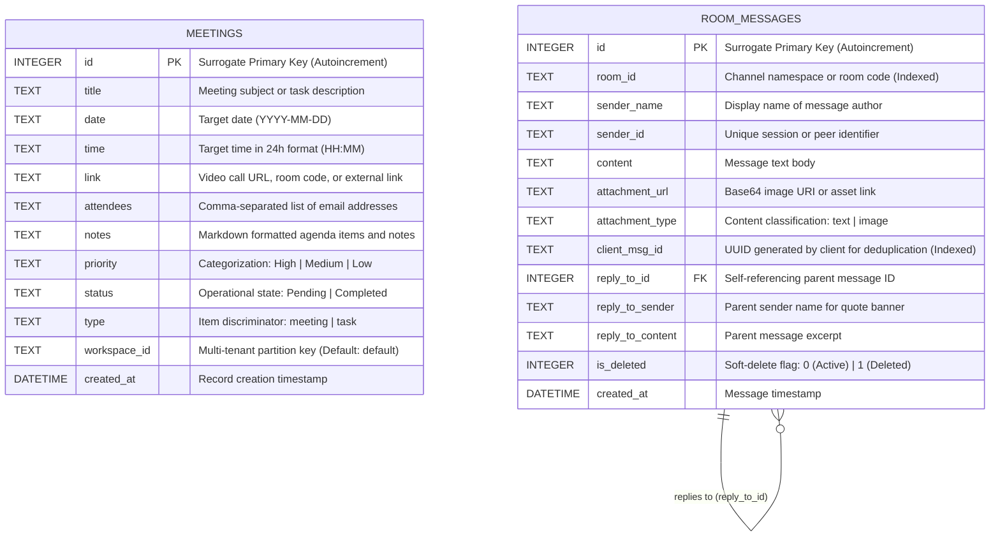

---

### 4.3 Full-System Conceptual & Logical Domain ER Diagram
This diagram models the entire domain architecture of PCS Meet Manager. It bridges physical database records, in-memory WebSocket signaling states, WebRTC peer topology, knocking lobby queues, email automation, and Chrome Extension alarms.

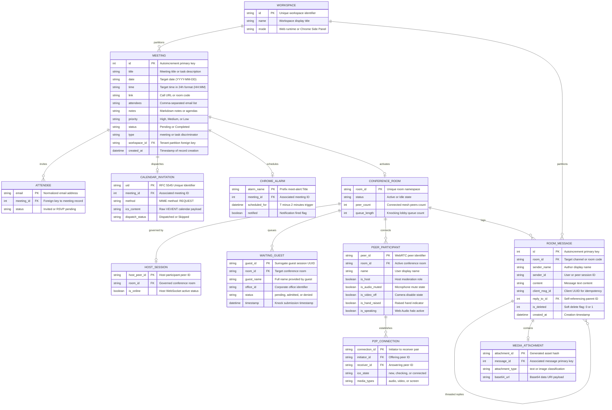

---

### 4.4 Comprehensive Entity Dictionary & Attribute Catalog

| Entity Name | Domain Scope | Storage Layer | Primary Key | Description & Cardinality |
| :--- | :--- | :--- | :--- | :--- |
| **`WORKSPACE`** | Tenancy | Client / Header | `id` (string) | Tenant boundary that scopes all tasks, meetings, and channels. One workspace contains many meetings and messages ($1:N$). |
| **`MEETING`** | Schedule | SQLite (`meetings`) | `id` (int autoincrement) | Core scheduling record. Can represent a collaborative video meeting or a discrete task depending on the `type` column. |
| **`ATTENDEE`** | Collaboration | Parsed / In-Memory | `email` (string) | Recipient parsed from `MEETING.attendees`. Receives automated email invites and RFC 5545 calendar files. |
| **`CALENDAR_INVITATION`**| Notification | SMTP Transport | `uid` (string) | Generated MIME iCalendar entity (`METHOD:REQUEST`) attached to invitation emails for one-click calendar import. |
| **`CHROME_ALARM`** | Extension | Chrome Storage API | `alarm_name` (string) | Pre-meeting desktop alarm registered $T - 2\text{ minutes}$ prior to call time via Chrome Manifest V3 Alarms API. |
| **`CONFERENCE_ROOM`** | Real-Time | Node.js Memory Map | `room_id` (string) | Real-time conference namespace. Manages host sockets, active mesh participants, and knocking lobby queues. |
| **`HOST_SESSION`** | Moderation | Node.js Memory Map | `host_peer_id` (string) | Active WebSocket connection holding host privileges; receives knock notifications and admits/denies guests. |
| **`WAITING_GUEST`** | Security | Node.js Memory Map | `guest_id` (string) | Queued attendee in the Corporate Knocking Lobby awaiting host approval with Full Name and Corporate Office ID. |
| **`PEER_PARTICIPANT`** | Media | Browser WebRTC | `peer_id` (string) | Connected video call member maintaining audio/video tracks, mute toggles, and Web Audio speaker halo state. |
| **`P2P_CONNECTION`** | WebRTC | Browser WebRTC | `connection_id` (string)| Direct DTLS-SRTP encrypted peer-to-peer connection between two calling nodes ($N \times (N-1) / 2$ mesh). |
| **`ROOM_MESSAGE`** | Chat | SQLite (`room_messages`) | `id` (int autoincrement) | Persistent channel message with client UUID idempotency, threaded quoted replies, and soft delete capabilities. |
| **`MEDIA_ATTACHMENT`** | Collaboration | SQLite / Lightbox | `attachment_id` (string)| Base64 data URI image payload pasted or dragged into chat, viewable in a full-screen interactive lightbox. |

---

### 4.5 Schema DDL, Constraints & Indexing Strategy

#### 1. Table: `meetings`
Stores scheduled meetings, operational tasks, and sprint goals partitioned by workspace.

```sql
CREATE TABLE IF NOT EXISTS meetings (
  id INTEGER PRIMARY KEY AUTOINCREMENT,
  title TEXT NOT NULL,
  date TEXT NOT NULL,
  time TEXT NOT NULL,
  link TEXT,
  attendees TEXT,
  notes TEXT,
  priority TEXT DEFAULT 'Medium',
  status TEXT DEFAULT 'Pending',
  type TEXT DEFAULT 'task',
  workspace_id TEXT DEFAULT 'default',
  created_at DATETIME DEFAULT CURRENT_TIMESTAMP
);
```

#### 2. Table: `room_messages`
Stores channel and in-call chat histories, threaded replies, and image assets.

```sql
CREATE TABLE IF NOT EXISTS room_messages (
  id INTEGER PRIMARY KEY AUTOINCREMENT,
  room_id TEXT NOT NULL,
  sender_name TEXT NOT NULL,
  sender_id TEXT,
  content TEXT,
  attachment_url TEXT,
  attachment_type TEXT DEFAULT 'text',
  client_msg_id TEXT,
  reply_to_id INTEGER,
  reply_to_sender TEXT,
  reply_to_content TEXT,
  is_deleted INTEGER DEFAULT 0,
  created_at DATETIME DEFAULT CURRENT_TIMESTAMP
);

CREATE INDEX IF NOT EXISTS idx_room_messages_room ON room_messages(room_id);
CREATE INDEX IF NOT EXISTS idx_room_messages_client_id ON room_messages(client_msg_id);
```

> [!TIP]
> **Idempotent Messaging:** The index on `client_msg_id` allows the server to detect and reject accidental duplicate submissions caused by network retries.

---

### 4.6 Server In-Memory State Models
Real-time WebRTC signaling and guest lobby queues are maintained in decoupled in-memory Maps on the Node.js server:

* `rooms`: `Map<roomId, RoomState>`
  - `hostSocket`: WebSocket connection of the registered meeting host.
  - `hostPeerId`: Peer ID string of the active room host.
  - `participants`: `Map<peerId, { ws, peerId, name, officeId, isHost, isAudioMuted, isVideoOff, isHandRaised }>`
  - `waitingGuests`: `Map<guestId, { id, name, officeId, ws, timestamp }>`
* `chatRooms`: `Map<roomId, Set<WebSocket>>`: Sockets subscribed to real-time chat broadcasts, presence updates, and typing notifications.

---

## 5. WebRTC Multi-Peer Mesh Calling Engine

### 5.1 Multi-User Mesh Architecture
PCS Meet Manager uses a **Fully Decentralized Multi-Peer WebRTC Mesh Network**:

* Every room participant opens a direct, peer-to-peer DTLS-SRTP encrypted audio/video connection (`RTCPeerConnection`) with every other participant in the room.
* When a new peer enters, the server provides an array of existing peer IDs (`room-users`).
* The new joiner acts as the **initiator** (`isInitiator = true`) and generates SDP offers for each existing peer.
* Existing peers receive `peer-joined`, configure their local connection handlers, and await incoming offers. This structured role assignment prevents offer/answer collisions (signaling glare).

```
          ┌────────────────────────────────────────────────┐
          │               [Peer C (Joiner)]                │
          │                   Initiator                    │
          └───────────▲────────────────────────▲───────────┘
                      │                        │
             SDP Offer / Answer       SDP Offer / Answer
             DTLS-SRTP Stream         DTLS-SRTP Stream
                      │                        │
          ┌───────────▼──────────┐  ┌──────────▼───────────┐
          │   [Peer A (Host)]    │◄─┼──────────────────────┤ [Peer B (Member)]
          │      Receiver        │  │       Receiver       │
          └──────────────────────┘  └──────────────────────┘
                     ▲                         ▲
                     └────────P2P Stream───────┘
```

### 5.2 Multi-Peer Signaling Sequence Diagram

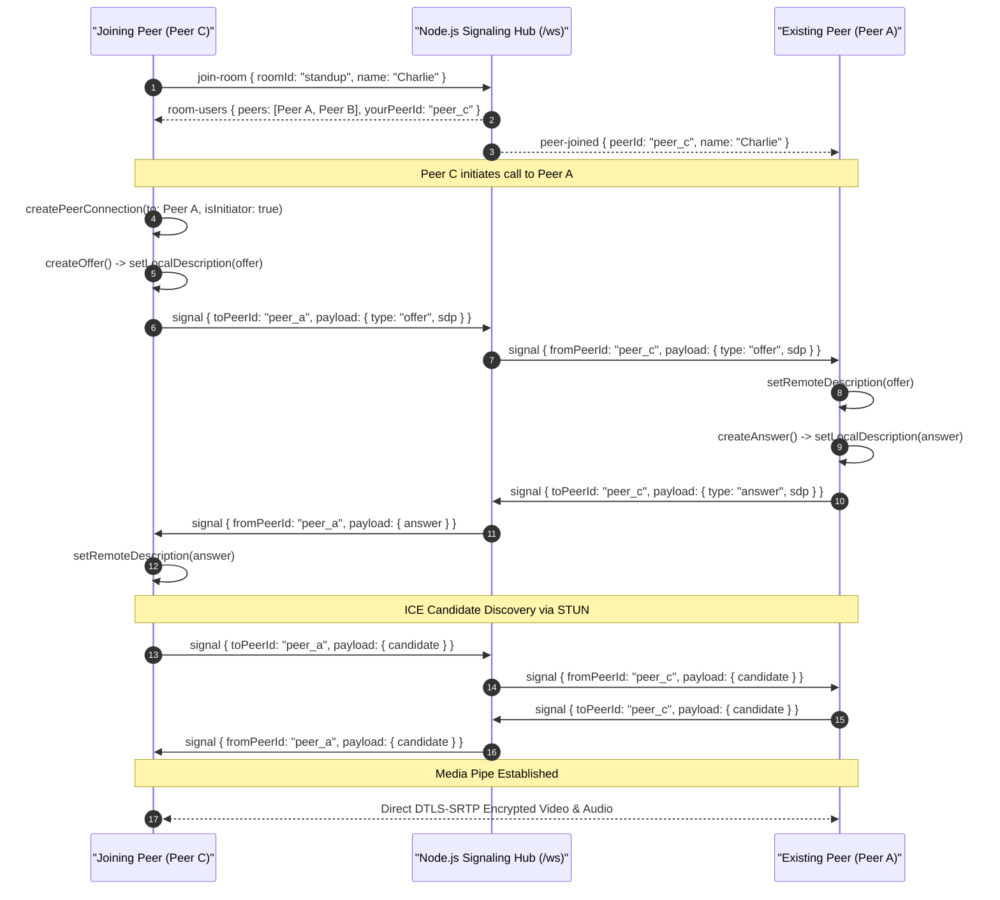

### 5.3 Active Speaker Detection via Web Audio API
Active speaker detection is executed entirely on the client, avoiding server audio processing:

1. A master browser `AudioContext` initializes upon joining a call.
2. For the local media stream and every remote participant stream, `createMediaStreamSource()` connects to an `AnalyserNode` (`fftSize = 256`).
3. A continuous `requestAnimationFrame` loop polls `getByteFrequencyData()`.
4. When average volume exceeds the sound threshold ($> 18$), the participant's `peerId` is flagged in the `speakingPeers` Set, activating a green animated halo ring around their video card.

### 5.4 Dynamic Responsive Video Grids & Spotlight Mode
The UI dynamically selects responsive CSS grid classes based on total active participants (`connectedPeers.length + 1`):

| Participant Count | CSS Grid Selector | Layout Pattern |
| :---: | :--- | :--- |
| **1 User** | `.grid-count-1` | Centered full-stage video canvas |
| **2 Users** | `.grid-count-2` | Side-by-side 50/50 split |
| **3–4 Users** | `.grid-count-4` | Balanced $2 \times 2$ grid |
| **5–6 Users** | `.grid-count-6` | Matrix grid ($3 \times 2$) |
| **7–9 Users** | `.grid-count-9` | Boardroom view ($3 \times 3$) |
| **10+ Users** | `.grid-count-many` | Responsive auto-fill tiles |

In **Spotlight Mode**, the pinned participant fills the hero canvas (`.meet-spotlight-hero`), while all other peers are placed in a horizontal scrollable bottom filmstrip (`.meet-filmstrip`).

### 5.5 Picture-in-Picture (PiP) Multitasking
Clicking the minimize button (`isCallMinimized = true`) docks the meeting into a floating PiP card in the lower corner of the viewport. This card displays the active speaker's video, a self-view preview, and floating controls for mic mute, camera toggle, maximize, and call end, allowing users to navigate tasks and calendar items while remaining in the call.

---

## 6. Corporate Knocking Lobby & Gatekeeping Handshake

### 6.1 Two-Phase Admission Protocol
External visitors accessing meetings via guest links (`?room=<code>`) enter a security gatekeeping lobby:

1. **Guest Verification:** Guests submit their Full Name and Corporate Office ID before connecting.
2. **Host Alert & Audio Chime:** The host receives a notification banner and a doorbell audio chime.
3. **Host Admission Action:** The host can admit or deny the guest individually, or admit all waiting guests at once.

### 6.2 Knocking Lobby Workflow Diagram

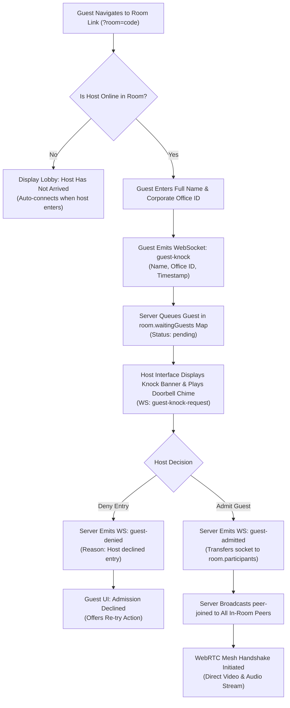

### 6.3 Bulk Admission ("Admit All")
When multiple attendees arrive simultaneously (`pendingKnocks.length > 1`), the host interface provides an **Admit All ({count})** button in both the top banner and the People tab. Clicking this button admits all queued guests in a single batch.

---

## 7. Global Real-Time Chat & Asset Collaboration

### 7.1 Channels, Presence & Messaging Flowchart
The chat engine functions across global workspace channels (`general`, `standup`) and within active video calls.

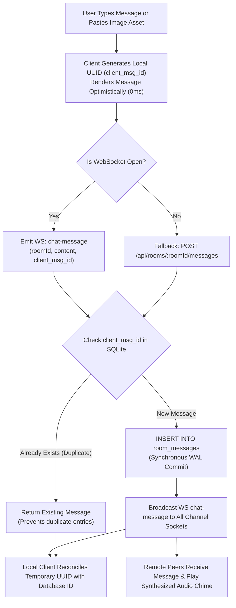

### 7.2 Threaded Replies, Media Lightbox & Soft Deletions
* **Threaded Replies:** Clicking reply populates the quote preview banner with the parent message's author and content excerpt, storing `reply_to_id`, `reply_to_sender`, and `reply_to_content` in SQLite.
* **In-Line Image Lightbox:** Dragging and dropping or pasting images (`Ctrl+V`) converts assets into Base64 data URIs. Clicking any image opens a full-screen interactive lightbox modal.
* **Soft Deletions:** Senders can delete their messages. The server updates `is_deleted = 1` and replaces the body with *"This message was deleted"*, preserving thread hierarchy.
* **Web Audio Notification Chimes:** Incoming messages trigger `playChatNotificationSound()`, which synthesizes dual-tone sine waves (800 Hz and 1000 Hz) using the Web Audio API, eliminating the need for external MP3 audio files.

---

## 8. Automated RFC 5545 Calendar Email Pipeline

### 8.1 Zero-Latency Asynchronous Trigger
When a meeting is scheduled via `POST /api/meetings`, the server returns an HTTP 201 response immediately, providing an instant UI experience. Email generation and SMTP transport execute asynchronously in the background.

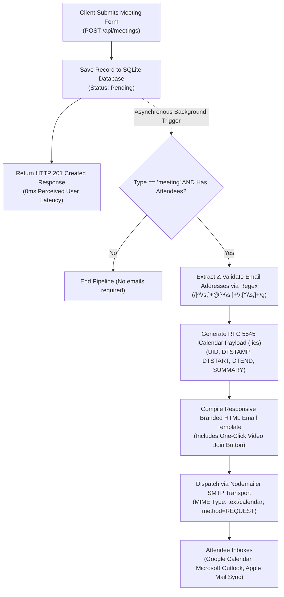

### 8.2 RFC 5545 iCalendar Payload Structure
The system generates standard iCalendar attachments using `METHOD:REQUEST` for single-click calendar imports:

```ics
BEGIN:VCALENDAR
VERSION:2.0
PRODID:-//PCS Meet Manager//Executive Meeting//EN
CALSCALE:GREGORIAN
METHOD:REQUEST
BEGIN:VEVENT
UID:pcs-1730985600000@meetmanager.com
DTSTAMP:20261106T000000Z
DTSTART:20261106T100000Z
SUMMARY:Sprint Architecture Review
DESCRIPTION:Agenda items and direct link: https://meetmanager.com?room=sprint-review
URL:https://meetmanager.com?room=sprint-review
STATUS:CONFIRMED
END:VEVENT
END:VCALENDAR
```

---

## 9. Chrome Extension Manifest V3 & Desktop Alarms

### 9.1 Background Service Worker Architecture
The extension complies with Google Chrome Manifest V3 standards:

* **Persistent Side Panel:** Clicking the browser toolbar icon triggers `chrome.sidePanel.setPanelBehavior({ openPanelOnActionClick: true })`.
* **Contextual Call Detection:** The "Auto-Detect Call Link" button inspects the active browser tab via `chrome.tabs.query()`. If the active tab is an active Google Meet, Zoom, or Teams call, its URL is automatically copied into the meeting link field.

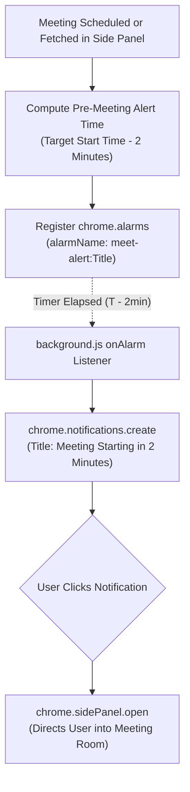

### 9.2 Automated Packaging Script
The packaging pipeline (`client/scripts/package-extension.js`) automates extension distribution:
1. Runs `vite build` to output production assets to `client/dist`.
2. Generates store-compliant PNG icons (`icon-16.png`, `icon-48.png`, `icon-128.png`).
3. Compresses `client/dist` into `pcs-meet-manager-extension.zip`.

---

## 10. Executive Productivity Cockpit & Viewports

### 10.1 Four Specialized Viewports

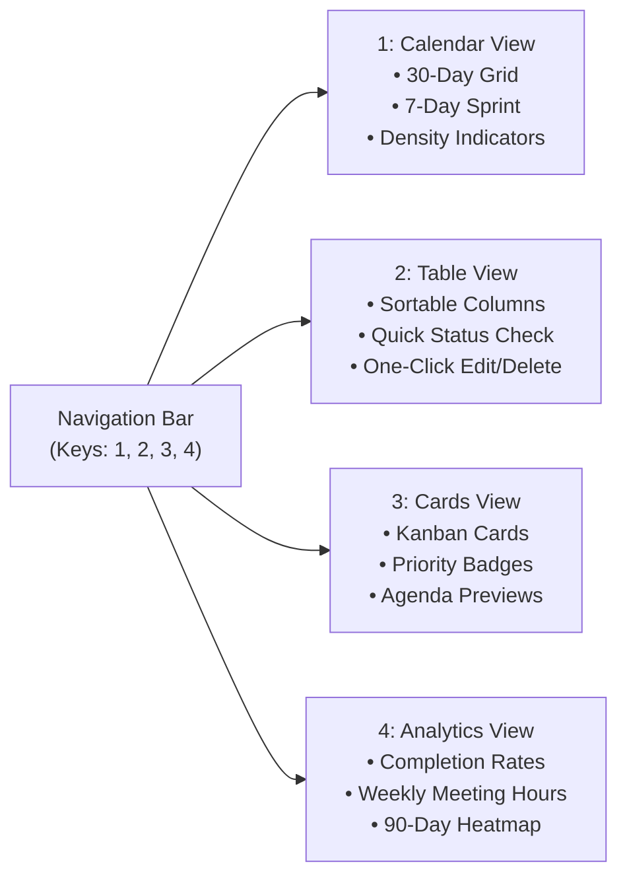

### 10.2 Executive Focus Modules

1. **Daily Standup Generator:** Parses all completed items from the past 24 hours, today's pending tasks, and upcoming meetings into a formatted Markdown report ready to copy into Slack or Teams.
2. **25-Minute Pomodoro Focus Timer:** Built-in focus sprint timer with circular progress ring, pause/resume controls, and audio alerts for working between meetings.
3. **Morning Overdue Triage:** Automatically flags past-due items and provides a one-click **Roll All to Today** bulk action.
4. **Notes-to-Tasks Converter:** Scans meeting agenda notes for Markdown checkbox items (`- [ ]`, `*`) and batch-converts them into standalone tasks in SQLite.

### 10.3 Complete Keyboard Shortcuts Cheatsheet

| Shortcut | Scope | Action |
| :--- | :--- | :--- |
| <kbd>Ctrl</kbd> + <kbd>K</kbd> / <kbd>Cmd</kbd> + <kbd>K</kbd> | Global | Open Command Palette |
| <kbd>1</kbd> | Global | Switch to Calendar View |
| <kbd>2</kbd> | Global | Switch to Table View |
| <kbd>3</kbd> | Global | Switch to Cards View |
| <kbd>4</kbd> | Global | Switch to Analytics View |
| <kbd>T</kbd> | Global | Open Quick Add Task Modal |
| <kbd>M</kbd> | Global | Open Quick Schedule Meeting Modal |
| <kbd>/</kbd> | Global | Focus Search Bar |
| <kbd>Ctrl</kbd> + <kbd>D</kbd> | In-Call | Toggle Microphone Mute |
| <kbd>Ctrl</kbd> + <kbd>E</kbd> | In-Call | Toggle Camera On/Off |
| <kbd>Esc</kbd> | Global | Close Active Drawer or Dismiss Modal |

---

## 11. Complete REST API Specification Reference

All endpoints are served from `/api` and consume/return `application/json`.

| Method | Endpoint | Rate Limit | Headers / Payload | Status | Description |
| :--- | :--- | :---: | :--- | :---: | :--- |
| `GET` | `/api/health` | Standard | None | `200` | Health check endpoint returning server and SQLite status. |
| `GET` | `/api/webrtc/ice-config` | Standard | None | `200` | Returns STUN/TURN server configurations and public URL. |
| `GET` | `/api/meetings` | Standard | `x-workspace-id: string` | `200` | Fetches all meetings and tasks for the specified workspace. |
| `POST` | `/api/meetings` | Strict | `x-workspace-id`, `{ title, date, time, link, attendees, notes, priority, status, type }` | `201` | Creates an item; triggers background RFC 5545 email invite if meeting. |
| `PUT` | `/api/meetings/:id` | Strict | `x-workspace-id`, `{ title, date, time, link, attendees, notes, priority, status }` | `200` | Updates an existing meeting or task record. |
| `DELETE` | `/api/meetings/:id` | Strict | `x-workspace-id: string` | `200` | Deletes an item from the specified workspace. |
| `GET` | `/api/public/live-meetings` | Standard | None | `200` | Public directory of today's meetings with live participant counts. |
| `GET` | `/api/public/room-status` | Standard | `?room=code` | `200` | Checks if a room has an active host and returns queue length. |
| `GET` | `/api/rooms/:roomId/messages` | Standard | None | `200` | Returns historical chat log (up to 300 messages) for the room. |
| `POST` | `/api/rooms/:roomId/messages` | Standard | `{ senderName, senderId, content, attachmentUrl, clientMsgId, replyToId }` | `201` | Saves a chat message to SQLite and broadcasts to the room. |
| `DELETE` | `/api/rooms/:roomId/messages/:id`| Standard | None | `200` | Soft-deletes a message (`is_deleted = 1`) and broadcasts removal. |

---

## 12. Complete WebSocket Event Protocol Specification (`/ws`)

The WebSocket server operates at path `/ws` over RFC 6455 protocols.

| Event Type | Direction | Payload Schema | Architectural Function |
| :--- | :---: | :--- | :--- |
| `host-join` | Client $\rightarrow$ Server | `{ type, roomId }` | Registers socket as meeting host; returns `host-ready` and pending lobby queue. |
| `join-room` | Client $\rightarrow$ Server | `{ type, roomId, name, officeId }` | Direct entry; returns `room-users` to joiner and broadcasts `peer-joined` to room. |
| `guest-knock` | Client $\rightarrow$ Server | `{ type, roomId, guest: { id, name, officeId } }` | Queues guest in waiting lobby; emits `guest-knock-request` to host socket. |
| `admit-guest` | Host $\rightarrow$ Server | `{ type, roomId, guestId }` | Admits guest; emits `guest-admitted` to guest and `peer-joined` to room. |
| `deny-guest` | Host $\rightarrow$ Server | `{ type, roomId, guestId, reason }` | Declines guest entry; emits `guest-denied` with dismissal reason. |
| `signal` | Bidirectional | `{ type, roomId, toPeerId, fromPeerId, payload }` | Relays WebRTC SDP Offer, SDP Answer, or ICE Candidate directly to target peer. |
| `peer-status` | Client $\rightarrow$ Server | `{ type, roomId, isAudioMuted, isVideoOff, isHandRaised }` | Broadcasts live mic, camera, or hand-raise state updates to all room peers. |
| `raise-hand` | Client $\rightarrow$ Server | `{ type, roomId, senderName, isRaised }` | Broadcasts hand-raise status notification across room participants. |
| `chat-join` | Client $\rightarrow$ Server | `{ type, roomId }` | Subscribes socket to room chat; broadcasts updated `chat-presence` count. |
| `chat-typing` | Client $\rightarrow$ Server | `{ type, roomId, senderName, isTyping }` | Relays ephemeral typing indicators to room subscribers. |
| `chat-message` | Bidirectional | `{ type, roomId, message: {...} }` | Persists message in SQLite and broadcasts to all room subscribers. |
| `chat-delete` | Bidirectional | `{ type, roomId, messageId }` | Sets soft-delete marker in SQLite and notifies connected room clients. |

---

## 13. Security, Hardening & Compliance Architecture

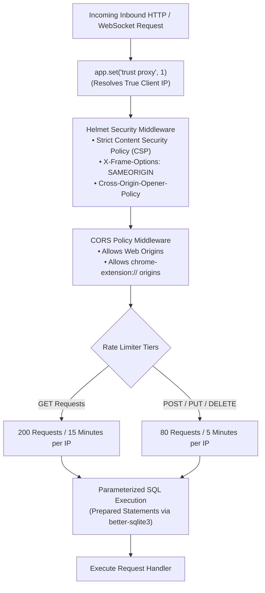

1. **Content Security Policy (CSP):** Relaxed specifically to permit inline scripts required by Vite HMR, Google Fonts stylesheets, WebRTC media streams (`blob:`), and WebSocket connections (`ws:`, `wss:`).
2. **Two-Tier DDoS Rate Limiting:** Global limiter prevents endpoint scraping, while strict write limiters protect database write operations from spam.
3. **CORS Policy for Chrome Extensions:** Explicitly allows requests originating from `chrome-extension://` schemes.
4. **SQL Injection Prevention:** 100% of queries use `better-sqlite3` prepared statements with parameterized inputs.

---

## 14. Environment Configuration Reference

Create a `.env` file in the `server/` directory based on the following reference:

```env
# Server Network Port
PORT=5000

# SQLite Database Storage Location (Supports absolute cloud volume paths)
DATABASE_PATH=./server/meetings.db

# Public URL (Used in automated email invitations and guest links)
PUBLIC_URL=https://meetmanager-p55v.onrender.com

# SMTP Outgoing Mail Configuration
SMTP_HOST=smtp.gmail.com
SMTP_PORT=587
SMTP_SECURE=false
SMTP_USER=your-email@gmail.com
SMTP_PASS=your-app-password
SMTP_FROM="PCS Meet Manager" <your-email@gmail.com>

# Optional Production TURN Relay Server
TURN_URL=
TURN_USERNAME=
TURN_CREDENTIAL=
```

---

## 15. Installation, Local Development & Deployment Guide

### 15.1 Quickstart Local Development

```bash
# 1. Clone the repository
git clone https://github.com/itssagarK/meetManager.git
cd meetManager

# 2. Install dependencies for all workspaces
npm install
cd server && npm install && cd ..
cd client && npm install && cd ..

# 3. Start development servers concurrently
# Terminal 1: Backend API & WebSocket Server (Port 5000)
npm run server

# Terminal 2: React Vite Client with Hot Module Replacement (Port 5173)
npm run client
```

### 15.2 Public HTTPS Tunneling (Testing on Mobile Devices)
To test cross-device video calling without deploying to a cloud host:

```bash
# Expose port 5000 via secure public HTTPS tunnel
npm run tunnel
```

### 15.3 Installing the Chrome Side Panel Extension
1. Run the packaging command:
   ```bash
   npm run package:extension
   ```
2. Open Chrome and navigate to `chrome://extensions`.
3. Enable **Developer mode** (top-right toggle).
4. Click **Load unpacked** and select the `client/dist` directory (or extract `pcs-meet-manager-extension.zip`).
5. Click the extension puzzle icon in Chrome and pin **PCS Meet Manager**. Click the icon to open the persistent side panel.

### 15.4 Production Docker Deployment
The repository includes a multi-stage `Dockerfile`:

```bash
# Build the container image
docker build -t pcs-meet-manager .

# Run the container with persistent storage
docker run -d \
  -p 5000:5000 \
  -v meet_data:/data \
  -e DATABASE_PATH=/data/meetings.db \
  --name meet-manager \
  pcs-meet-manager
```

---

## 16. Troubleshooting & Frequently Asked Questions (FAQ)

<details>
<summary><strong>Q1: Why is my camera or microphone not showing in the video call?</strong></summary>

* **Browser Permissions:** Ensure your browser has granted camera and microphone permissions for the site.
* **HTTPS Requirement:** WebRTC requires a secure context (`https://` or `localhost`). If testing over a local network IP (e.g., `http://192.168.x.x`), browsers will block camera access. Use `npm run tunnel` to obtain a valid HTTPS URL.
</details>

<details>
<summary><strong>Q2: Why are automated email invitations not being delivered?</strong></summary>

* Verify your SMTP credentials in `server/.env`.
* For Gmail, use an **App Password** rather than your primary Google account password.
* When SMTP is unconfigured, meetings are still saved successfully, and the server logs: `[SMTP Not Configured] Skipped sending automated invite...`.
</details>

<details>
<summary><strong>Q3: How do guests join meetings without an account?</strong></summary>

* Direct guests to the meeting link (e.g., `https://your-domain.com?room=sprint-review`).
* The guest will see the **Corporate Knocking Lobby**, enter their name, and wait for the meeting host to admit them.
</details>

<details>
<summary><strong>Q4: Why does the Chrome Side Panel say "Server Disconnected"?</strong></summary>

* Ensure the backend server is running on port 5000 (`npm run server`).
* The extension connects to `http://localhost:5000` by default. If using a remote server, update `DEFAULT_BACKEND_ORIGIN` in `client/src/App.jsx`.
</details>

---

## 17. Strategic Engineering Roadmap

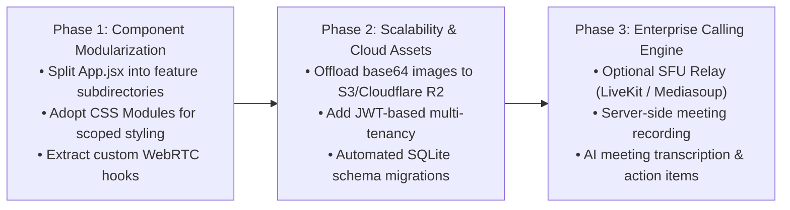

* **Phase 1 (Component Modularization):** Decompose the single `App.jsx` orchestrator into focused components (`components/views`, `components/webrtc`, `components/chat`).
* **Phase 2 (Cloud Asset Storage):** Transition from Base64 data URIs in SQLite to object storage (AWS S3 or Cloudflare R2), storing clean CDN URLs in the database.
* **Phase 3 (Enterprise Calling & SFU):** Introduce an optional Selective Forwarding Unit (SFU) for large-scale conferences with 8+ participants, while preserving lightweight P2P mesh for 1:1 and small team calls.

---

<div align="center">

**PCS Meet Manager** • Engineered for focused productivity and seamless real-time collaboration.

*Maintained by the Executive Engineering Team • Version 2.0.0*

</div>
