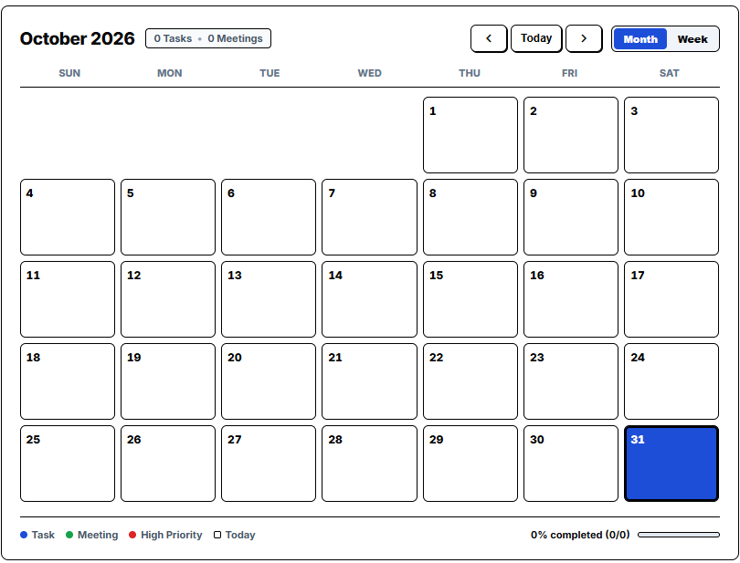
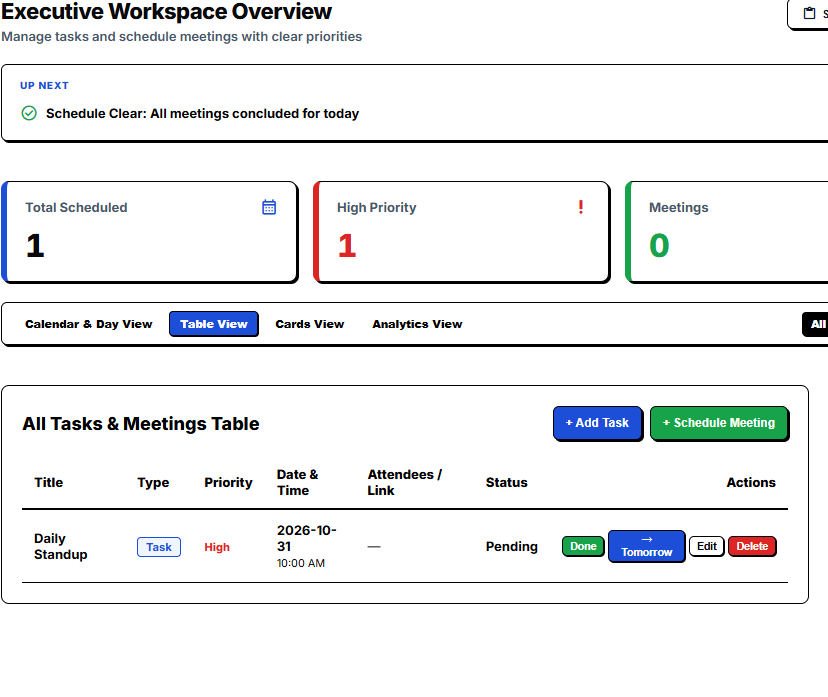
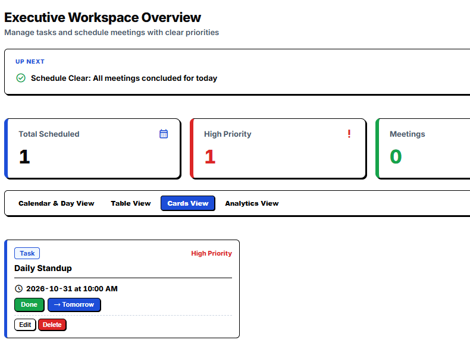
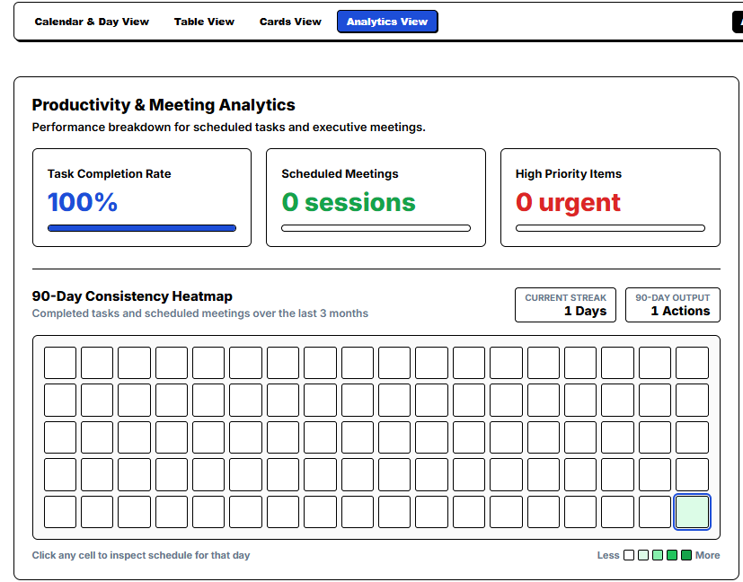
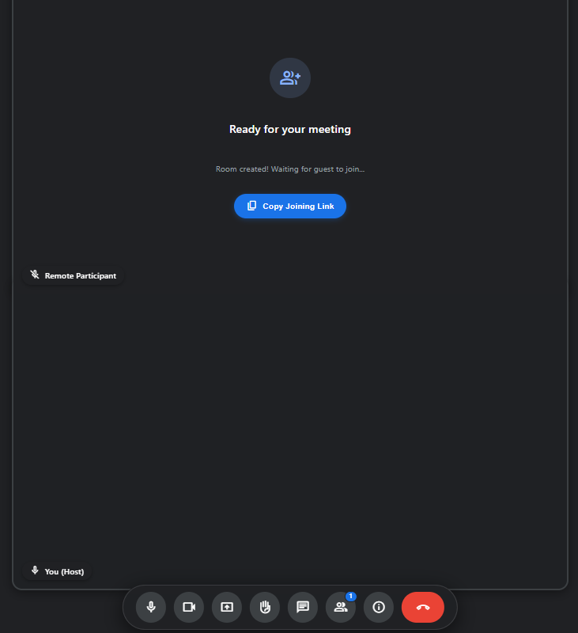
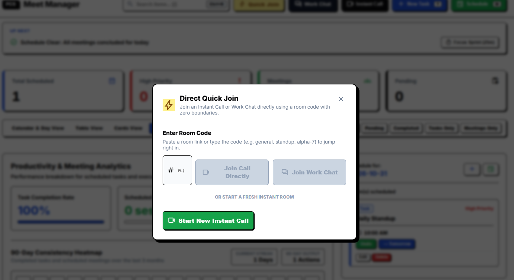
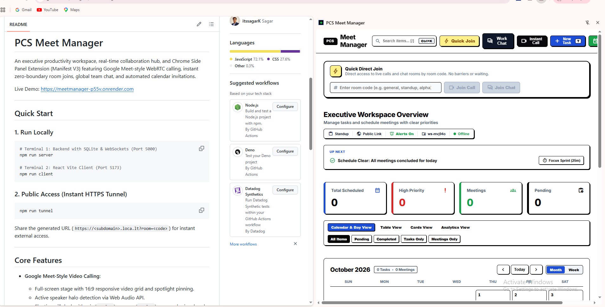
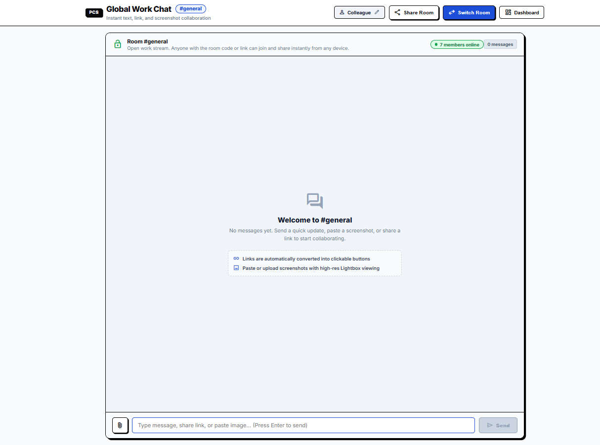

# PCS Meet Manager

An executive productivity workspace, real-time collaboration hub, and Chrome Side Panel Extension (Manifest V3) featuring Google Meet-style WebRTC calling, instant zero-boundary room joins, global team chat, and automated calendar invitations.

Live Demo: [https://meetmanager-p55v.onrender.com](https://meetmanager-p55v.onrender.com)

---

## Quick Start

### 1. Run Locally
```bash
# Terminal 1: Backend with SQLite & WebSockets (Port 5000)
npm run server

# Terminal 2: React Vite Client (Port 5173)
npm run client
```

### 2. Public Access (Instant HTTPS Tunnel)
```bash
npm run tunnel
```
Share the generated URL (`https://<subdomain>.loca.lt?room=<code>`) for instant external access.

---

## Core Features

- **Google Meet-Style Video Calling**:
  - Full-screen stage with 16:9 responsive video grid and spotlight pinning.
  - Active speaker halo detection via Web Audio API.
  - Floating pill dock with mic (`Ctrl+D`), camera (`Ctrl+E`), screen sharing, hand raising, and call end controls.
  - Collapsible side drawer with in-call chat, attendee list, knocking lobby admission, and meeting info.
  - Picture-in-Picture (PiP) multitasking mode for working during calls.

- **Zero-Boundaries Quick Join**:
  - Join any video call or chat room instantly with a room code. No registration required for guests.

- **Real-Time Global Chat**:
  - Live messaging with typing indicators, presence counters, reply threads, image attachments, and deletion options.

- **Executive Productivity Workspace**:
  - Calendar, table, card, and analytics views.
  - Daily standup generator, 25-minute Pomodoro sprint buffer, and overdue task triage.
  - Automated HTML email invites with RFC 5545 `.ics` calendar attachments.
  - Global command palette (`Ctrl+K`).

---

## Chrome Extension (Manifest V3 Side Panel)

PCS Meet Manager includes a pre-packaged extension: `pcs-meet-manager-extension.zip`.

### Installation
1. Extract `pcs-meet-manager-extension.zip` or use `client/dist`.
2. Open Chrome and navigate to `chrome://extensions`.
3. Enable **Developer mode** (top right).
4. Click **Load unpacked** and select the folder.
5. Pin **PCS Meet Manager** and open the side panel to manage tasks and calls alongside work.

To rebuild the extension package:
```bash
npm run package:extension
```

---

## Keyboard Shortcuts

| Shortcut | Action |
| :--- | :--- |
| `Ctrl+K` / `Cmd+K` | Open Command Palette |
| `Ctrl+D` / `Cmd+D` | Toggle Microphone (in-call) |
| `Ctrl+E` / `Cmd+E` | Toggle Camera (in-call) |
| `T` | Quick Add Task |
| `M` | Quick Schedule Meeting |
| `/` | Focus Search Bar |
| `1` / `2` / `3` / `4` | Switch Views (Calendar, Table, Cards, Analytics) |
| `Esc` | Close Drawer / Dismiss Modal |

---

## Tech Stack

- **Extension**: Manifest V3, Chrome Side Panel API, Alarms, Notifications
- **Frontend**: React 19, Vite, Material Symbols, Touch-First CSS
- **Backend**: Node.js, Express, WebSocket (`ws`), Nodemailer
- **Database**: SQLite (`better-sqlite3` in WAL mode)

---
## Screenshots


| Calendar view | Table view |
| :---: | :---: |
|  |  |

| Cards view | Analytics view |
| :---: | :---: |
|  |  |

| Video call (speaker halo) | Guest knock and admit |
| :---: | :---: |
|  |  |

| Chrome Side Panel | Chat with lightbox |
| :---: | :---: |
|  |  |
## Author

Sagar ([@itssagarK](https://github.com/itssagarK))
