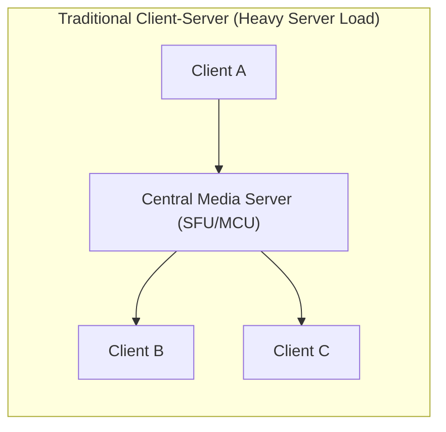
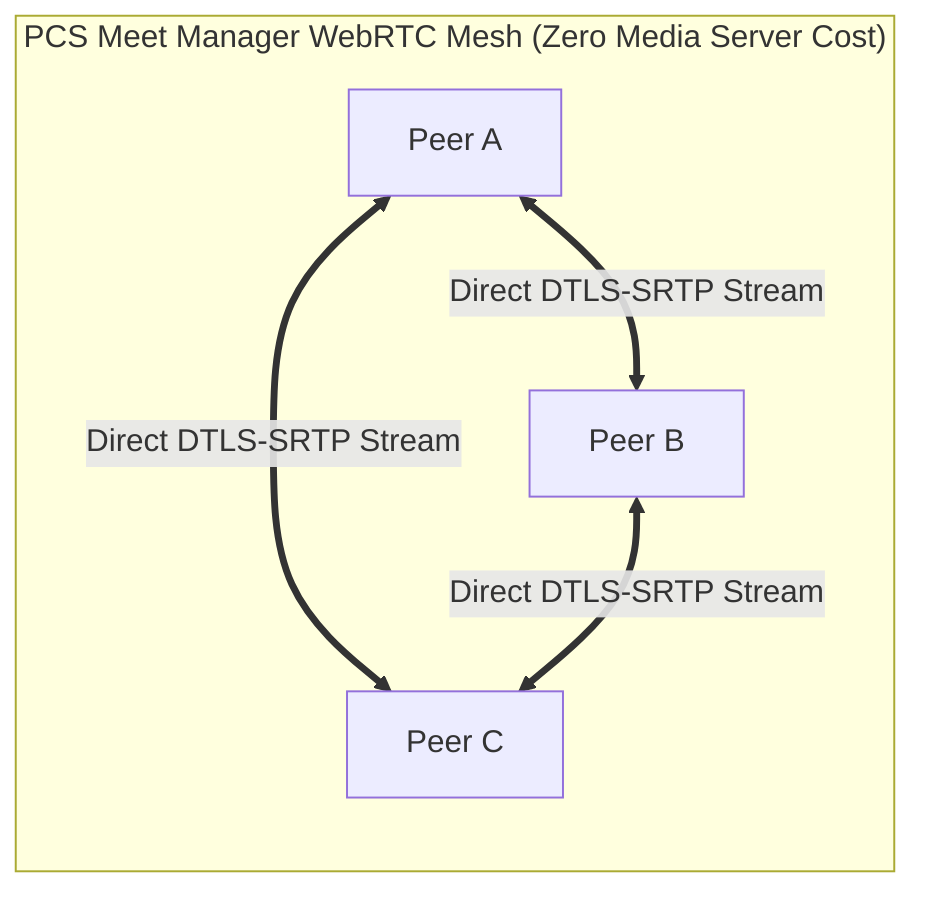
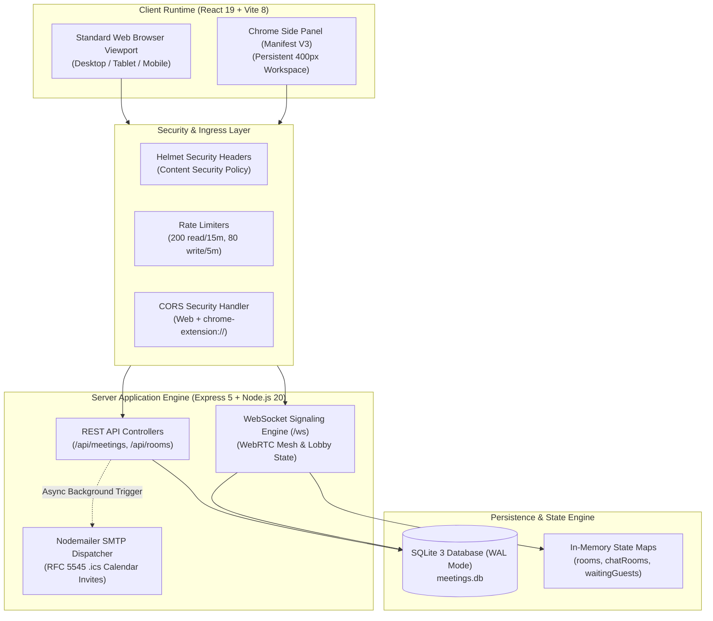
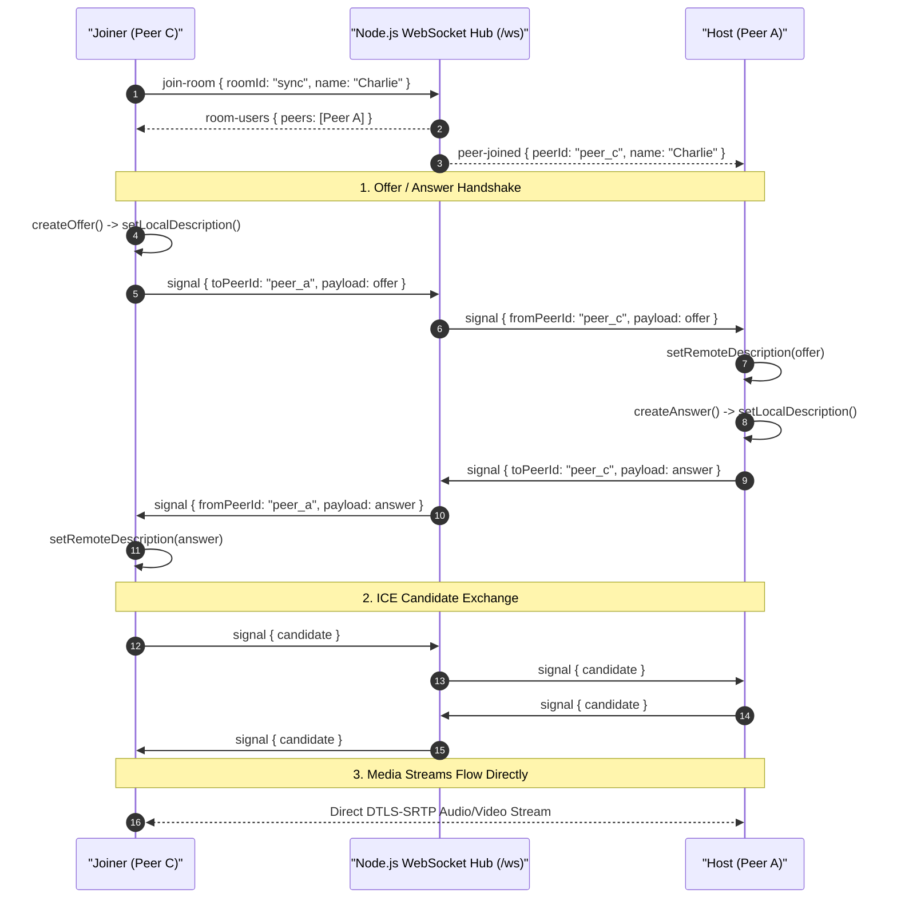
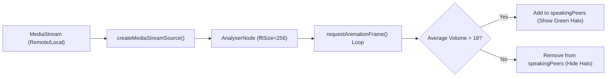
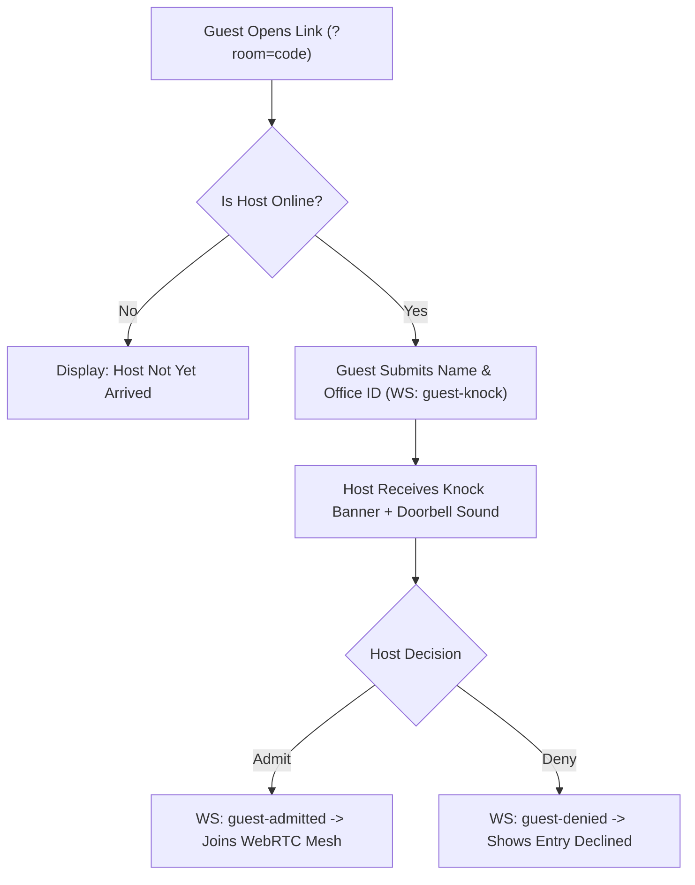
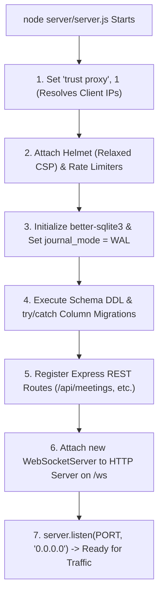

# 🎓 PCS Meet Manager — The Zero-to-Hero Developer Study Guide
### *How This Full-Stack Real-Time Workspace Was Built from Scratch*

<div align="center">

[](docs/README.md)
[](#)
[](#)

</div>

Welcome to the definitive **developer study manual** for **PCS Meet Manager**. Whether you are a junior developer, an experienced engineer new to WebRTC, or an engineering manager reviewing the codebase, this document breaks down **every single concept, file, subsystem, and architecture design pattern** used to construct this production project.

---

## 📑 Table of Contents

1. [The Big Picture: What Are We Building?](#1-the-big-picture-what-are-we-building)
2. [Core Mental Models for Beginners](#2-core-mental-models-for-beginners)
   - [2.1 Client-Server vs Peer-to-Peer (WebRTC)](#21-client-server-vs-peer-to-peer-webrtc)
   - [2.2 HTTP REST vs WebSockets](#22-http-rest-vs-websockets)
   - [2.3 Embedded SQLite in WAL Mode vs Heavy Databases](#23-embedded-sqlite-in-wal-mode-vs-heavy-databases)
   - [2.4 Optimistic UI Updates ($0\text{ ms}$ Perceived Latency)](#24-optimistic-ui-updates-0ms-perceived-latency)
   - [2.5 The Dual-Runtime Architecture (Web & Chrome Extension MV3)](#25-the-dual-runtime-architecture-web--chrome-extension-mv3)
3. [The Complete System Blueprint](#3-the-complete-system-blueprint)
4. [Backend Deep Dive (`server/server.js`)](#4-backend-deep-dive-serverserverjs)
   - [4.1 Security Ingress: Helmet, CORS, and Rate Limiting](#41-security-ingress-helmet-cors-and-rate-limiting)
   - [4.2 The SQLite Engine & Resilient Database Migrations](#42-the-sqlite-engine--resilient-database-migrations)
   - [4.3 REST API Endpoints Step-by-Step](#43-rest-api-endpoints-step-by-step)
   - [4.4 Automated RFC 5545 iCalendar (`.ics`) Email Pipeline](#44-automated-rfc-5545-icalendar-ics-email-pipeline)
   - [4.5 The WebSocket Signaling Hub (`/ws`)](#45-the-websocket-signaling-hub-ws)
5. [Frontend Deep Dive (`client/src/App.jsx`)](#5-frontend-deep-dive-clientsrcappjsx)
   - [5.1 Environment Detection & Dual-Runtime Layouts](#51-environment-detection--dual-runtime-layouts)
   - [5.2 State Management Inventory: The Brain of the App](#52-state-management-inventory-the-brain-of-the-app)
   - [5.3 WebRTC Video Calling Engine from Scratch](#53-webrtc-video-calling-engine-from-scratch)
   - [5.4 Web Audio API Active Speaker Halo Detection](#54-web-audio-api-active-speaker-halo-detection)
   - [5.5 The Corporate Knocking Lobby & Gatekeeping Handshake](#55-the-corporate-knocking-lobby--gatekeeping-handshake)
   - [5.6 Real-Time Chat, Threaded Quotes & Image Lightbox](#56-real-time-chat-threaded-quotes--image-lightbox)
   - [5.7 The 4 Executive Viewports (Calendar, Table, Cards, Analytics)](#57-the-4-executive-viewports-calendar-table-cards-analytics)
   - [5.8 Executive Focus Modules (Standup, Pomodoro, Triage, Notes-to-Tasks)](#58-executive-focus-modules-standup-pomodoro-triage-notes-to-tasks)
6. [Chrome Extension Manifest V3 Subsystem](#6-chrome-extension-manifest-v3-subsystem)
   - [6.1 The Manifest (`client/public/manifest.json`)](#61-the-manifest-clientpublicmanifestjson)
   - [6.2 Background Service Worker & Alarms (`background.js`)](#62-background-service-worker--alarms-backgroundjs)
   - [6.3 Programmatic Icon Generation & Extension Packaging](#63-programmatic-icon-generation--extension-packaging)
7. [End-to-End Data Flow Scenarios](#7-end-to-end-data-flow-scenarios)
   - [Scenario A: Scheduling a Meeting & Emailing Attendees](#scenario-a-scheduling-a-meeting--emailing-attendees)
   - [Scenario B: Guest Knocking, Host Admitting, and Media Mesh Negotiation](#scenario-b-guest-knocking-host-admitting-and-media-mesh-negotiation)
   - [Scenario C: Sending an Image Message with Optimistic UI](#scenario-c-sending-an-image-message-with-optimistic-ui)
8. [Beginner Glossary: Jargon Explained Simply](#8-beginner-glossary-jargon-explained-simply)
9. [Developer Exercises & Modification Challenges](#9-developer-exercises--modification-challenges)
10. [Tech Stack Selection & Architectural Decisions](#10-tech-stack-selection--architectural-decisions)
11. [Project Startup & Bootstrap Lifecycle](#11-project-startup--bootstrap-lifecycle)
12. [Important Code Blocks & API Connections Traced](#12-important-code-blocks--api-connections-traced)
13. [Complete Feature-to-Code Mapping Directory](#13-complete-feature-to-code-mapping-directory)

---

## 1. The Big Picture: What Are We Building?

When executives, software engineers, and distributed teams work during the day, they suffer from **context switching**. They keep 5 to 10 browser tabs open:
- Tab 1: Google Calendar (to check when their next call starts)
- Tab 2: Linear / Jira / Todoist (to check their task list)
- Tab 3: Slack / Teams (to talk to colleagues)
- Tab 4: Google Meet / Zoom (for active video calls)
- Tab 5: Code editor or documentation (where actual work happens)

**PCS Meet Manager** unifies all four tools into a single, high-speed workspace that can either run as a **standard web application** or dock directly into Google Chrome as a **persistent Side Panel (`chrome.sidePanel`)** right next to active browser tabs!

```
┌────────────────────────────────────────────────────────────────────────┐
│                        PCS MEET MANAGER COCKPIT                        │
├─────────────────────┬────────────────────┬─────────────────────────────┤
│  1. Video Engine    │  2. Productivity   │  3. Real-Time Chat & Sync   │
│  • P2P WebRTC Mesh  │  • Calendar View   │  • Persistent Channel Chat  │
│  • Active Audio Halo│  • Sprint Table    │  • Image Lightbox           │
│  • Knocking Lobby   │  • Kanban Cards    │  • Quoted Threaded Replies  │
│  • Dynamic Grids    │  • Daily Standup   │  • RFC 5545 .ics Calendar   │
│  • Picture-in-Pic   │  • Pomodoro Sprint │  • Chrome MV3 Desktop Alarm │
└─────────────────────┴────────────────────┴─────────────────────────────┘
```

---

## 2. Core Mental Models for Beginners

To understand the code, you need to master five fundamental concepts. Let's break each down in plain English:

### 2.1 Client-Server vs Peer-to-Peer (WebRTC)



In traditional video calling apps (like Zoom or Twitch), every video stream is sent to a central cloud server, processed, and redistributed. This requires massive server bandwidth, expensive cloud instances, and high CPU loads.



**How PCS Meet Manager does it (WebRTC Mesh):**
- Media (audio, video, screen share) flows **directly between browsers** using encrypted P2P channels (`RTCPeerConnection`).
- The backend Node.js server **never touches video frames**.
- The server only acts as a **Signaling Matchmaker** (introducing peers to each other via WebSockets). Once peers are connected, they stream video directly to each other!

> [!NOTE]
> **What are STUN and TURN?**
> - Most computers live behind home/office Wi-Fi routers (NAT) and don't know their public IP address.
> - A **STUN Server** (Google provides free public STUN servers) acts like a mirror: your browser asks *"What is my public IP and port?"*, and STUN answers back.
> - A **TURN Server** is a relay used only if extreme corporate firewalls block direct P2P connections.

---

### 2.2 HTTP REST vs WebSockets

| Feature | HTTP REST API (`fetch` / Express) | WebSocket (`ws` / RFC 6455) |
| :--- | :--- | :--- |
| **Connection Model** | Request $\rightarrow$ Response $\rightarrow$ Close | Persistent, bi-directional, full-duplex TCP tunnel |
| **Latency** | 50ms – 300ms (handshake per request) | 1ms – 5ms (instant transmission) |
| **Initiator** | Only the client can ask for data | Both client AND server can push data anytime |
| **Best Used For** | CRUD (Fetch meetings, save settings, health check) | Signaling WebRTC, guest knocking doorbell, typing indicators, live chat |

In PCS Meet Manager:
- We use **REST (`/api/...`)** for standard data loading (fetching meetings, saving new tasks).
- We use **WebSockets (`/ws`)** for everything that must happen instantly in real-time (SDP signaling, knocking lobby alerts, chat messages, typing events).

---

### 2.3 Embedded SQLite in WAL Mode vs Heavy Databases

Most modern web tutorials teach PostgreSQL or MySQL. However, PostgreSQL requires installing a background daemon, configuring database users, setting up passwords, and running migrations across Docker containers.

```
┌─────────────────────────────────────────────────────────────┐
│                    NODE.JS APPLICATION                      │
│                                                             │
│   better-sqlite3 (Native C++ Bindings)                      │
│   ├── Direct memory calls (No network roundtrips)           │
│   ├── Microsecond execution speed                           │
│   └── Write-Ahead Logging (WAL) Mode                        │
│                                                             │
│                    meetings.db                               │
│              (Self-contained on disk)                       │
└─────────────────────────────────────────────────────────────┘
```

**Why SQLite was chosen:**
1. **Single File Storage:** The entire database lives in `./server/meetings.db`. You can copy it, back it up, or mount it to a Docker volume in 1 second.
2. **Synchronous Native Speed:** `better-sqlite3` calls SQLite's C++ libraries directly in process memory without network latency.
3. **Write-Ahead Logging (`WAL`):** Configured via `db.pragma('journal_mode = WAL');`. In traditional SQLite, a write locks the entire database. In WAL mode, SQLite appends writes to a separate `.db-wal` log file, allowing **unlimited concurrent reads** while a write is occurring!

---

### 2.4 Optimistic UI Updates ($0\text{ ms}$ Perceived Latency)

When an executive checks off a task or sends a chat message, they hate seeing a loading spinner.

**How Optimistic UI works in PCS Meet Manager:**
1. User types *"Here is the latest design"* and hits Enter.
2. The client generates a temporary local UUID (`temp-1731...`) and **instantly renders the message in the chat list**. Time: $0\text{ ms}$.
3. In the background, the message is emitted over the WebSocket to the server.
4. The server commits it to SQLite and returns the permanent database record.
5. The client seamlessly reconciles the temporary record with the database record.
6. If the network drops, the user sees an error indicator without the interface freezing.

---

### 2.5 The Dual-Runtime Architecture (Web & Chrome Extension MV3)

Rather than maintaining two separate codebases (one for web and one for the Chrome Extension), PCS Meet Manager uses **a single React 19 codebase** that detects where it is running:

```javascript
// client/src/App.jsx (Line 4)
const isChromeExtension = typeof window !== 'undefined' && window.location.protocol === 'chrome-extension:';
```

- When running in a standard tab: It renders a wide, spacious desktop layout with full calendar grids and multi-tile video grids.
- When running inside `chrome.sidePanel`: It automatically applies `.chrome-panel-mode` CSS classes, narrowing the navigation into a compact vertical tab strip tailored for 360px–400px sidebars.

---

## 3. The Complete System Blueprint



---

## 4. Backend Deep Dive (`server/server.js`)

Open [`server/server.js`](file:///C:/Users/Mini-PC/Desktop/projects/PCS/PCSprojects/meetManager/server/server.js) to follow along.

### 4.1 Security Ingress: Helmet, CORS, and Rate Limiting
Lines 22–65 handle enterprise-grade protection:
- **`app.set('trust proxy', 1);`**: Necessary when deploying to cloud platforms like Render or behind Nginx/Cloudflare, so the server can inspect the real client IP.
- **Helmet Content Security Policy (CSP):**
  ```javascript
  helmet({
    contentSecurityPolicy: {
      directives: {
        defaultSrc: ["'self'"],
        scriptSrc: ["'self'", "'unsafe-inline'"],
        styleSrc: ["'self'", "'unsafe-inline'", 'https://fonts.googleapis.com'],
        fontSrc: ["'self'", 'https://fonts.gstatic.com'],
        connectSrc: ["'self'", 'ws:', 'wss:', 'https://*.google.com'],
        mediaSrc: ["'self'", 'blob:'],
        imgSrc: ["'self'", 'data:', 'blob:'],
      },
    },
    crossOriginEmbedderPolicy: false,
  })
  ```
  *Why this matters:* We explicitly allow `blob:` for WebRTC local media camera streams and `ws:`/`wss:` for real-time signaling.
- **Two-Tier Rate Limiting (`express-rate-limit`):**
  - Tier 1: 200 requests per 15 minutes across read-only endpoints.
  - Tier 2: 80 requests per 5 minutes on mutating endpoints (`POST`, `PUT`, `DELETE` on `/api/meetings`), preventing spam attacks.

### 4.2 The SQLite Engine & Resilient Database Migrations
Lines 70–165 initialize the database:
```javascript
const dbPath = process.env.DATABASE_PATH || path.join(__dirname, 'meetings.db');
const db = new Database(dbPath);
db.pragma('journal_mode = WAL');
```

**Resilient Migrations with `try...catch`:**
Notice how new columns were added to existing databases without breaking active production data:
```javascript
try {
  db.exec("ALTER TABLE meetings ADD COLUMN priority TEXT DEFAULT 'Medium'");
} catch (e) {} // If the column already exists, SQLite throws; we catch and proceed safely!
```

### 4.3 REST API Endpoints Step-by-Step
- **`GET /api/health`**: Simple probe returning `{ status: 'ok', database: 'connected' }`.
- **`GET /api/webrtc/ice-config`**: Supplies clients with STUN/TURN server URLs and derives the canonical public URL.
- **`GET /api/meetings`**: Scoped by the `x-workspace-id` HTTP request header for multi-tenancy.
- **`POST /api/meetings`**: Creates a meeting or task.
  ```javascript
  const itemType = type || (link || (attendees && attendees.trim() !== '') ? 'meeting' : 'task');
  ```
  If `itemType === 'meeting'` and attendees are provided, it automatically dispatches calendar emails asynchronously!

### 4.4 Automated RFC 5545 iCalendar (`.ics`) Email Pipeline
Lines 220–355 manage automated calendar synchronization:
1. **Extraction:** A regular expression (`/[\w.-]+@[\w.-]+\.[a-zA-Z]{2,}/g`) extracts all email addresses from the `attendees` text field.
2. **RFC 5545 `.ics` Generation:**
   ```javascript
   const generateIcsAttachment = ({ title, date, time, link, notes }) => {
     const cleanDate = (date || '').replace(/-/g, '');
     const uid = `pcs-${Date.now()}@meetmanager.com`;
     return [
       'BEGIN:VCALENDAR',
       'VERSION:2.0',
       'PRODID:-//PCS Meet Manager//EN',
       'METHOD:REQUEST',
       'BEGIN:VEVENT',
       `UID:${uid}`,
       `DTSTAMP:${cleanDate}T000000Z`,
       `DTSTART:${cleanDate}T100000Z`,
       `SUMMARY:${title}`,
       `DESCRIPTION:${notes || 'Scheduled via PCS Meet Manager'}`,
       `URL:${link || ''}`,
       'STATUS:CONFIRMED',
       'END:VEVENT',
       'END:VCALENDAR',
     ].join('\r\n');
   };
   ```
3. **MIME Email Dispatch:** Nodemailer attaches this buffer with `contentType: 'text/calendar; charset=utf-8; method=REQUEST'`. When Gmail or Outlook receives this email, it automatically parses it as an interactive calendar invite!

### 4.5 The WebSocket Signaling Hub (`/ws`)
Lines 620–1080 implement the real-time core:
- **`rooms` Map:** `Map<roomId, { hostSocket, hostPeerId, participants, waitingGuests }>`
- **`chatRooms` Map:** `Map<roomId, Set<WebSocket>>`

**Key WebSocket Events Handled:**
- `host-join`: Identifies the socket as the room host and sends them any queued knocking guests.
- `join-room`: Directly joins an in-progress call and receives the list of connected peers (`room-users`).
- `guest-knock`: Puts an external guest into `waitingGuests` and notifies the host socket with a doorbell sound.
- `admit-guest`: Host approves guest; server moves socket to `participants` and tells peers to connect.
- `signal`: Relays WebRTC SDP Offers, Answers, and ICE candidates between peers.
- `chat-message`: Saves message to SQLite and broadcasts to all room subscribers.

---

## 5. Frontend Deep Dive (`client/src/App.jsx`)

Open [`client/src/App.jsx`](file:///C:/Users/Mini-PC/Desktop/projects/PCS/PCSprojects/meetManager/client/src/App.jsx).

### 5.1 Environment Detection & Dual-Runtime Layouts
The app inspects `window.location.protocol`:
- If `chrome-extension:`, the API URL defaults to `http://localhost:5000` (or your cloud URL), enabling seamless cross-origin requests.
- The UI applies `.chrome-panel-mode`, condensing wide views into a vertical side panel.

### 5.2 State Management Inventory: The Brain of the App
Notice the key state hooks in `App.jsx` (Lines 136–260):

| State Variable | Type | Purpose |
| :--- | :---: | :--- |
| `items` | `Array` | The list of all meetings and tasks loaded for the active workspace. |
| `workspaceId` | `string` | Tenant identifier (persisted in `localStorage: mm_workspace_id`). |
| `activeCallRoom` | `string` | The active video call room code (e.g. `standup`, `sprint-sync`). |
| `connectedPeers` | `Array` | Active peers in the WebRTC call (`peerId`, `name`, `stream`, `isAudioMuted`). |
| `speakingPeers` | `Set` | Peer IDs currently producing audio above the threshold (active speaker halo). |
| `pendingKnocks` | `Array` | Guests waiting in the knocking lobby for host admission. |
| `chatMessages` | `Array` | Messages in the currently open chat room. |
| `viewMode` | `string` | Active cockpit viewport: `'calendar'`, `'table'`, `'cards'`, or `'analytics'`. |
| `replyingTo` | `Object` | Parent message being quoted in a threaded reply. |

---

### 5.3 WebRTC Video Calling Engine from Scratch

How do two browsers talk to each other without a media server?



**Understanding the Code in `App.jsx`:**
1. **Acquire Camera/Mic:** `navigator.mediaDevices.getUserMedia({ video: true, audio: true })`.
2. **Create Connection:** `const pc = new RTCPeerConnection(iceServers)`.
3. **Add Local Tracks:** `localStream.getTracks().forEach(track => pc.addTrack(track, localStream))`.
4. **Listen for Remote Tracks:**
   ```javascript
   pc.ontrack = (event) => {
     const remoteStream = event.streams[0];
     // Attach this remote stream to a video element in React state!
   };
   ```

---

### 5.4 Web Audio API Active Speaker Halo Detection

How does the app highlight active speakers with a glowing green ring without server processing?



```javascript
// Web Audio API implementation
const audioContext = new (window.AudioContext || window.webkitAudioContext)();
const analyser = audioContext.createAnalyser();
analyser.fftSize = 256;
const source = audioContext.createMediaStreamSource(stream);
source.connect(analyser);

const dataArray = new Uint8Array(analyser.frequencyBinCount);
const checkVolume = () => {
  analyser.getByteFrequencyData(dataArray);
  const averageVolume = dataArray.reduce((acc, val) => acc + val, 0) / dataArray.length;
  if (averageVolume > 18) {
    // Flag this participant as speaking!
  }
  requestAnimationFrame(checkVolume);
};
```

---

### 5.5 The Corporate Knocking Lobby & Gatekeeping Handshake



1. External guests join with a URL parameter: `?room=executive-sync`.
2. The guest submits their **Full Name** and **Corporate Office ID**.
3. The server queues them in `waitingGuests`.
4. The host's browser plays a synthesized doorbell sound and displays an admission strip with **Admit**, **Deny**, or **Admit All ({count})**.

---

### 5.6 Real-Time Chat, Threaded Quotes & Image Lightbox

- **Threaded Replies:** Clicking reply populates `replyingTo = { id, sender, content }`. When submitted, the server stores `reply_to_id`, saving conversational context.
- **Base64 Image Sharing:**
  ```javascript
  const reader = new FileReader();
  reader.onload = (e) => {
    const base64Url = e.target.result;
    // Broadcast base64Url to the chat room!
  };
  reader.readAsDataURL(file);
  ```
  Clicking any image opens a full-screen lightbox modal.
- **Synthesized Notification Chimes:** When a chat message arrives, the browser synthesizes dual-frequency sine waves (800 Hz & 1000 Hz) using the Web Audio API, so the app doesn't need to load external MP3 audio files!

---

### 5.7 The 4 Executive Viewports (Calendar, Table, Cards, Analytics)

1. **Calendar View (`calSubView: 'month' | 'week'`):** Interactive 30-day grid with density dots and a 7-day executive sprint view.
2. **Table View:** Sortable tabular display with inline status checkboxes and priority color tags.
3. **Cards View:** Kanban-style card matrix with Markdown preview and one-click video launch links.
4. **Analytics View:** Computes completion rates, estimated weekly meeting hours, a 90-day activity heatmap, and streak counters.

---

### 5.8 Executive Focus Modules (Standup, Pomodoro, Triage, Notes-to-Tasks)

- **Daily Standup Generator:** Automatically aggregates all tasks completed in the last 24 hours, today's pending items, and upcoming meetings into a formatted Markdown report ready to copy into Slack or Teams.
- **25-Minute Pomodoro Focus Timer:** Built-in sprint timer with circular countdown ring, pause/play, and chime alerts.
- **Morning Overdue Triage:** Detects tasks with past due dates (`date < today`) and offers a single-click **Roll All to Today** bulk action.
- **Notes-to-Tasks Converter:** Scans Markdown meeting agenda text for checkbox patterns (`- [ ]`, `*`) and batch-creates standalone tasks.

---

## 6. Chrome Extension Manifest V3 Subsystem

### 6.1 The Manifest (`client/public/manifest.json`)
```json
{
  "manifest_version": 3,
  "name": "PCS Meet Manager",
  "version": "1.0.0",
  "side_panel": {
    "default_path": "index.html"
  },
  "permissions": ["sidePanel", "alarms", "notifications", "storage", "tabs"],
  "background": {
    "service_worker": "background.js"
  }
}
```

### 6.2 Background Service Worker & Alarms (`background.js`)
```javascript
// 1. Open persistent Side Panel when user clicks the extension toolbar icon
chrome.runtime.onInstalled.addListener(() => {
  if (chrome.sidePanel && chrome.sidePanel.setPanelBehavior) {
    chrome.sidePanel.setPanelBehavior({ openPanelOnActionClick: true });
  }
});

// 2. Pre-Meeting Desktop Alarm Listener (triggers 2 minutes before scheduled calls)
chrome.alarms.onAlarm.addListener((alarm) => {
  if (alarm.name.startsWith('meet-alert:')) {
    const meetingTitle = alarm.name.replace('meet-alert:', '');
    chrome.notifications.create({
      type: 'basic',
      iconUrl: 'icon-128.png',
      title: 'Upcoming Meeting - PCS Meet Manager',
      message: `"${meetingTitle}" starts in 2 minutes.`,
      priority: 2,
    });
  }
});
```

---

## 7. End-to-End Data Flow Scenarios

### Scenario A: Scheduling a Meeting & Emailing Attendees
```
User Submits Form
  │
  ├──> React: Calls POST /api/meetings with payload
  │      │
  │      └──> Express: Executes INSERT INTO meetings
  │             │
  │             ├──> Returns HTTP 201 Created (0ms UI latency)
  │             │
  │             └──> Background: Async Worker triggers sendMeetingEmailNotification()
  │                    ├──> Regex extracts attendee emails
  │                    ├──> Formats RFC 5545 .ics payload (METHOD:REQUEST)
  │                    └──> Nodemailer dispatches email via SMTP
```

### Scenario B: Guest Knocking, Host Admitting, and Media Mesh Negotiation
```
1. Guest visits ?room=design-review
2. Guest enters name "Alice" and Office ID "NY-04" -> emits WS: guest-knock
3. Server puts Alice in room.waitingGuests Map
4. Host socket receives WS: guest-knock-request -> plays doorbell chime
5. Host clicks "Admit" -> emits WS: admit-guest
6. Server moves Alice to room.participants -> emits WS: guest-admitted
7. Alice acts as Initiator -> creates SDP Offer to Host
8. Host returns SDP Answer
9. Both exchange ICE Candidates via Server (/ws)
10. Direct DTLS-SRTP P2P video stream begins!
```

---

## 8. Beginner Glossary: Jargon Explained Simply

| Term | Simple Definition |
| :--- | :--- |
| **WebRTC** | *Web Real-Time Communication.* An open standard enabling browsers to stream video and audio directly to each other without plugins or intermediate servers. |
| **SDP** | *Session Description Protocol.* A text document that your browser creates describing its video resolution, audio codecs, and network capabilities to share with peers. |
| **ICE Candidate** | A network address (IP address and port) where a browser can be reached. Browsers exchange several candidates to discover the fastest connection route. |
| **STUN Server** | A lightweight public server that tells your browser what its public IP address is when connecting from behind a Wi-Fi router. |
| **WAL Mode** | *Write-Ahead Logging.* An SQLite configuration where write operations are appended to a separate log file, allowing simultaneous reads without database locking. |
| **Manifest V3** | Google Chrome's latest extension standard, replacing persistent background pages with event-driven background service workers. |
| **RFC 5545** | The international specification for `.ics` calendar files used by Google Calendar, Apple Calendar, and Microsoft Outlook. |
| **Optimistic UI** | An interface pattern where the frontend updates immediately when a user takes an action, before waiting for the server to confirm the save over the network. |

---

## 9. Developer Exercises & Modification Challenges

Want to test your understanding of the codebase? Try completing these three real-world developer exercises:

### Challenge 1: Add an Audio Mute Indicator in the Chat Room
- **Goal:** When someone speaks in a video call, display a mini microphone icon next to their name in the chat panel.
- **Files to touch:** [`client/src/App.jsx`](file:///C:/Users/Mini-PC/Desktop/projects/PCS/PCSprojects/meetManager/client/src/App.jsx).
- **Hint:** Inspect `speakingPeers.has(msg.sender_id)` inside the message rendering loop.

### Challenge 2: Add a 50-Minute "Long Sprint" Pomodoro Mode
- **Goal:** Allow users to toggle between a 25-minute standard sprint and a 50-minute deep work sprint.
- **Files to touch:** [`client/src/App.jsx`](file:///C:/Users/Mini-PC/Desktop/projects/PCS/PCSprojects/meetManager/client/src/App.jsx).
- **Hint:** Look for `pomodoroTime` state and add a duration selector toggle.

### Challenge 3: Add a Slack Webhook Notification for Standups
- **Goal:** In addition to copying the Markdown standup report, add a "Send to Slack" button that posts to an incoming webhook URL.
- **Files to touch:** [`server/server.js`](file:///C:/Users/Mini-PC/Desktop/projects/PCS/PCSprojects/meetManager/server/server.js) and [`client/src/App.jsx`](file:///C:/Users/Mini-PC/Desktop/projects/PCS/PCSprojects/meetManager/client/src/App.jsx).

---

## 10. Tech Stack Selection & Architectural Decisions

Why was this exact stack chosen? In modern engineering, every architectural decision is a set of trade-offs between speed, simplicity, operational overhead, and maintainability.

### 10.1 Tier-by-Tier Stack Rationale

```
┌─────────────────────────────────────────────────────────────────────────────┐
│                          FULL-STACK TECHNOLOGY MATRIX                       │
├─────────────────────┬──────────────────────────┬────────────────────────────┤
│ Technology          │ Role in Project          │ Why Chosen vs Alternative  │
├─────────────────────┼──────────────────────────┼────────────────────────────┤
│ React 19            │ Frontend Core SPA        │ Declarative UI; latest     │
│                     │                          │ concurrent rendering.      │
│ Vite 8              │ Bundler & Dev Server     │ Sub-second HMR vs slow CRA/│
│                     │                          │ Webpack; dual-build target.│
│ Material Symbols    │ Icons & Visual Glyphs    │ Google variable fonts; zero│
│                     │                          │ runtime JS icon overhead.  │
│ Touch-First CSS     │ Responsive Styling       │ Zero CSS-in-JS overhead;   │
│                     │                          │ fluid side panel overrides.│
│ Node.js 20 (LTS)    │ Server Engine Runtime    │ Modern ES Modules, native  │
│                     │                          │ WebCrypto, long-term LTS.  │
│ Express 5           │ HTTP REST Routing        │ Async error handling; clean│
│                     │                          │ middleware ecosystem.      │
│ better-sqlite3      │ Database Engine          │ Synchronous C++ speed; WAL │
│                     │                          │ mode; zero external daemon.│
│ ws (RFC 6455)       │ Real-Time WebSocket Hub  │ Zero-bloat native sockets; │
│                     │                          │ 10x lighter than Socket.io.│
│ WebRTC Native API   │ Multi-Peer Calling Mesh  │ $0 media server cloud cost;│
│                     │                          │ native browser encryption. │
│ Web Audio API       │ Sound & Halo Analysis    │ Client FFT frequency check;│
│                     │                          │ synthesized audio chimes.  │
│ Nodemailer          │ Email Transport          │ RFC 5545 .ics calendar MIME│
│                     │                          │ generator and SMTP relay.  │
│ Chrome Manifest V3  │ Extension Platform       │ Persistent sidePanel API   │
│                     │                          │ and battery-friendly alarms│
└─────────────────────┴──────────────────────────┴────────────────────────────┘
```

### 10.2 Why We Rejected Common Alternatives

1. **Why Not PostgreSQL or MySQL?**
   - *The Problem:* Requires running an independent background database server, configuring connection pools (`pg-pool`), managing SSL certificates, and setting up Docker networks.
   - *The Solution:* **SQLite with Write-Ahead Logging (`WAL`)** provides microsecond execution directly in memory via C++ bindings. The entire database is contained in `./server/meetings.db`, which can be backed up or mounted to Docker volumes in one command.
2. **Why Not Socket.io?**
   - *The Problem:* Socket.io adds a heavy client library (~45KB), introduces custom packet framing, and relies on HTTP long-polling fallbacks that add unnecessary complexity.
   - *The Solution:* The lightweight **`ws`** library adheres strictly to RFC 6455 standards, using standard browser `new WebSocket()` APIs without client dependencies.
3. **Why Not a Central Media Server (SFU/MCU like LiveKit or Janus)?**
   - *The Problem:* An SFU requires dedicated cloud servers, high bandwidth charges ($0.10/GB+), and complex video transcoding pipelines.
   - *The Solution:* For executive and small-team collaboration (2 to 4 attendees), a **Decentralized WebRTC Mesh** costs $0 in cloud server media bandwidth because video packets travel directly between participant browsers.
4. **Why Not Tailwind CSS or Component Libraries (MUI/Chakra)?**
   - *The Problem:* Heavy component libraries inflate bundle sizes, introduce CSS specificity battles, and struggle to cleanly adapt to 360px Chrome Side Panel viewports.
   - *The Solution:* A unified stylesheet ([`client/src/App.css`](file:///C:/Users/Mini-PC/Desktop/projects/PCS/PCSprojects/meetManager/client/src/App.css)) with CSS custom properties (`var(--primary)`, `var(--bg)`), fluid CSS grids, and clean `.chrome-panel-mode` overrides.

---

## 11. Project Startup & Bootstrap Lifecycle

Here is the exact lifecycle trace from typing `npm run ...` in your terminal to pixels appearing on the screen.

### 11.1 The Workspace Orchestration (`package.json`)

When you run commands from the repository root:
- **`npm run server`** $\rightarrow$ Changes directory to `server/` and runs `npm start` (`node server.js`).
- **`npm run client`** $\rightarrow$ Changes directory to `client/` and runs `vite` on port `5173`.
- **`npm run tunnel`** $\rightarrow$ Invokes `npx localtunnel --port 5000` to create an HTTPS tunnel for cross-device mobile testing.
- **`npm run package:extension`** $\rightarrow$ Runs `vite build` into `client/dist`, runs icon generation, and zips the bundle into `pcs-meet-manager-extension.zip`.

### 11.2 The Server Bootstrap Sequence (Step-by-Step)



1. **Proxy Trust:** `app.set('trust proxy', 1)` enables reverse proxies (Render, Cloudflare, Nginx) to pass true client IPs to our rate limiters.
2. **Security Headers:** Helmet applies CSP rules that explicitly permit `blob:` (camera streams) and `ws:`/`wss:` (WebSockets).
3. **Database Mount:** `meetings.db` is opened and immediately placed into WAL mode (`db.pragma('journal_mode = WAL')`).
4. **Safe Migrations:** Schema tables `meetings` and `room_messages` are created if they do not exist. Columns (`priority`, `type`, `workspace_id`, `client_msg_id`) are added using safe `try { db.exec("ALTER TABLE ...") } catch (e) {}` blocks.
5. **WebSocket Attachment:** The `WebSocketServer` binds to the underlying Node HTTP server on path `/ws`.
6. **Network Binding:** `server.listen(5000, '0.0.0.0')` binds to all network interfaces, allowing local LAN devices and tunnels to connect.

### 11.3 The Client Bootstrap Sequence (Step-by-Step)

1. **DOM Entry:** The browser loads [`client/index.html`](file:///C:/Users/Mini-PC/Desktop/projects/PCS/PCSprojects/meetManager/client/index.html), preloading the Inter font and Google Material Symbols.
2. **React Mount:** [`client/src/main.jsx`](file:///C:/Users/Mini-PC/Desktop/projects/PCS/PCSprojects/meetManager/client/src/main.jsx) executes `ReactDOM.createRoot()`, wrapping `<App />` in `<React.StrictMode>`.
3. **Runtime Detection:** [`client/src/App.jsx`](file:///C:/Users/Mini-PC/Desktop/projects/PCS/PCSprojects/meetManager/client/src/App.jsx) checks if `window.location.protocol === 'chrome-extension:'`.
   - If true: Sets `DEFAULT_BACKEND_ORIGIN = 'http://localhost:5000'` and applies `.chrome-panel-mode`.
   - If false: Uses relative paths (`/api/...`).
4. **Local State Hydration:** React checks `localStorage.getItem('mm_workspace_id')`. If none exists, it generates a unique workspace ID (e.g., `ws-abc123`).
5. **Mount `useEffect`:**
   - Calls `GET /api/health` to verify server connectivity.
   - Calls `GET /api/webrtc/ice-config` to load STUN/TURN configurations.
   - Calls `GET /api/meetings` to fetch the tenant's tasks and meetings.
   - Connects WebSocket to `ws://localhost:5000/ws`.

---

## 12. Important Code Blocks & API Connections Traced

Let's trace the seven most critical data flows in the project from frontend to backend.

### 12.1 Trace 1: Loading Workspace Meetings (`GET /api/meetings`)

```
[React UI Mount]
  └── fetch('/api/meetings', { headers: { 'x-workspace-id': workspaceId } })
        └── [Express Route] app.get('/api/meetings')
              └── [SQLite] db.prepare('SELECT * FROM meetings WHERE workspace_id = ? ...').all(wsId)
                    └── [HTTP 200] JSON items returned
                          └── React: setItems(data) & saves to localStorage cache
```

- **Frontend Code ([`client/src/App.jsx`](file:///C:/Users/Mini-PC/Desktop/projects/PCS/PCSprojects/meetManager/client/src/App.jsx)):**
  ```javascript
  const fetchItems = async () => {
    try {
      const res = await fetch(getApiUrl('/api/meetings'), {
        headers: { 'x-workspace-id': workspaceId },
      });
      if (res.ok) {
        const data = await res.json();
        setItems(data);
        localStorage.setItem(`mm_cached_items_${workspaceId}`, JSON.stringify(data));
      }
    } catch (err) {
      console.error('Fetch error:', err);
    }
  };
  ```
- **Backend Code ([`server/server.js`](file:///C:/Users/Mini-PC/Desktop/projects/PCS/PCSprojects/meetManager/server/server.js)):**
  ```javascript
  app.get('/api/meetings', (req, res) => {
    const workspaceId = getWorkspaceId(req);
    const items = db.prepare(
      'SELECT * FROM meetings WHERE workspace_id = ? ORDER BY date ASC, time ASC'
    ).all(workspaceId);
    res.json(items);
  });
  ```

---

### 12.2 Trace 2: Creating a Meeting & Email Dispatch (`POST /api/meetings`)

```
[Form Submit]
  └── POST /api/meetings { title, date, time, attendees, type: 'meeting' }
        └── Express: INSERT INTO meetings
              ├── HTTP 201 Created sent to client immediately (0ms UI delay)
              └── Background Promise: sendMeetingEmailNotification(newItem)
                    ├── Regex extracts: colleague@company.com
                    ├── Generates RFC 5545 .ics attachment buffer
                    └── Nodemailer SMTP transmits invitation
```

- **Frontend Code ([`client/src/App.jsx`](file:///C:/Users/Mini-PC/Desktop/projects/PCS/PCSprojects/meetManager/client/src/App.jsx)):**
  ```javascript
  const res = await fetch(getApiUrl('/api/meetings'), {
    method: 'POST',
    headers: { 'Content-Type': 'application/json', 'x-workspace-id': workspaceId },
    body: JSON.stringify(formData),
  });
  const savedItem = await res.json();
  setItems((prev) => [...prev, savedItem]);
  ```
- **Backend Code ([`server/server.js`](file:///C:/Users/Mini-PC/Desktop/projects/PCS/PCSprojects/meetManager/server/server.js)):**
  ```javascript
  app.post('/api/meetings', (req, res) => {
    const workspaceId = getWorkspaceId(req);
    const { title, date, time, link, attendees, notes, priority, status, type } = req.body;
    const itemType = type || (link || (attendees && attendees.trim() !== '') ? 'meeting' : 'task');

    const stmt = db.prepare(`
      INSERT INTO meetings (title, date, time, link, attendees, notes, priority, status, type, workspace_id)
      VALUES (?, ?, ?, ?, ?, ?, ?, ?, ?, ?)
    `);
    const result = stmt.run(title, date, time, link || '', attendees || '', notes || '', priority || 'Medium', status || 'Pending', itemType, workspaceId);
    const newItem = db.prepare('SELECT * FROM meetings WHERE id = ?').get(result.lastInsertRowid);

    // Asynchronous background email trigger
    if (itemType === 'meeting' && attendees && attendees.trim()) {
      sendMeetingEmailNotification(newItem).catch((err) => console.error('Email error:', err));
    }

    res.status(201).json(newItem);
  });
  ```

---

### 12.3 Trace 3: Sending a Chat Message with Optimistic UI & Idempotency

```
User Hits Send
  ├── 1. Generate client UUID (client_msg_id)
  ├── 2. Optimistically render message in React (0ms)
  └── 3. Send over WebSocket: { type: 'chat-message', roomId, message }
           └── Server: Checks client_msg_id in SQLite
                 ├── Exists? -> Return existing (deduplication)
                 └── New? -> INSERT INTO room_messages
                       ├── Broadcast to all sockets in chatRooms.get(roomId)
                       └── Client reconciles temp-id with SQLite id
```

- **Backend Deduplication Code ([`server/server.js`](file:///C:/Users/Mini-PC/Desktop/projects/PCS/PCSprojects/meetManager/server/server.js)):**
  ```javascript
  function saveRoomMessage(targetRoom, chatMsg) {
    const clientMsgId = chatMsg.clientMsgId || chatMsg.client_msg_id || null;
    if (clientMsgId) {
      const existing = db.prepare('SELECT * FROM room_messages WHERE client_msg_id = ?').get(clientMsgId);
      if (existing) return existing; // Prevents duplicate messages on network reconnects
    }

    const stmt = db.prepare(`
      INSERT INTO room_messages (room_id, sender_name, sender_id, content, attachment_url, attachment_type, client_msg_id, reply_to_id, reply_to_sender, reply_to_content, is_deleted)
      VALUES (?, ?, ?, ?, ?, ?, ?, ?, ?, ?, 0)
    `);
    const result = stmt.run(targetRoom, chatMsg.senderName, chatMsg.senderId, chatMsg.content, chatMsg.attachmentUrl, chatMsg.attachmentType, clientMsgId, chatMsg.replyToId, chatMsg.replyToSender, chatMsg.replyToContent);
    return db.prepare('SELECT * FROM room_messages WHERE id = ?').get(result.lastInsertRowid);
  }
  ```

---

### 12.4 Trace 4: The WebRTC Multi-Peer Connection Handshake

Here is the exact WebRTC factory in [`client/src/App.jsx`](file:///C:/Users/Mini-PC/Desktop/projects/PCS/PCSprojects/meetManager/client/src/App.jsx):

```javascript
const createPeerConnection = (targetPeerId, targetName, isInitiator = false) => {
  const pc = new RTCPeerConnection({ iceServers: iceServersList });

  // 1. Attach our local microphone and camera tracks
  if (localStreamRef.current) {
    localStreamRef.current.getTracks().forEach((track) => {
      pc.addTrack(track, localStreamRef.current);
    });
  }

  // 2. Transmit discovered ICE candidates to target peer via server
  pc.onicecandidate = (event) => {
    if (event.candidate && wsRef.current?.readyState === WebSocket.OPEN) {
      wsRef.current.send(JSON.stringify({
        type: 'signal',
        roomId: activeCallRoom,
        toPeerId: targetPeerId,
        fromPeerId: myPeerId,
        payload: { candidate: event.candidate },
      }));
    }
  };

  // 3. Receive incoming remote media track
  pc.ontrack = (event) => {
    const remoteStream = event.streams[0];
    setConnectedPeers((prev) => {
      const idx = prev.findIndex((p) => p.peerId === targetPeerId);
      if (idx !== -1) {
        const updated = [...prev];
        updated[idx] = { ...updated[idx], stream: remoteStream };
        return updated;
      }
      return [...prev, { peerId: targetPeerId, name: targetName, stream: remoteStream }];
    });
  };

  // 4. If we are the initiator, create and send the SDP offer
  if (isInitiator) {
    pc.createOffer()
      .then((offer) => pc.setLocalDescription(offer))
      .then(() => {
        wsRef.current.send(JSON.stringify({
          type: 'signal',
          roomId: activeCallRoom,
          toPeerId: targetPeerId,
          fromPeerId: myPeerId,
          payload: { type: 'offer', sdp: pc.localDescription },
        }));
      });
  }

  return pc;
};
```

---

### 12.5 Trace 5: Web Audio Frequency Analyzer for Active Speaker Detection

This code in [`client/src/App.jsx`](file:///C:/Users/Mini-PC/Desktop/projects/PCS/PCSprojects/meetManager/client/src/App.jsx) powers the green active speaker halo:

```javascript
const attachAudioAnalyser = (stream, peerId) => {
  try {
    const audioContext = new (window.AudioContext || window.webkitAudioContext)();
    const analyser = audioContext.createAnalyser();
    analyser.fftSize = 256;
    analyser.smoothingTimeConstant = 0.4;

    const source = audioContext.createMediaStreamSource(stream);
    source.connect(analyser);

    const bufferLength = analyser.frequencyBinCount;
    const dataArray = new Uint8Array(bufferLength);

    const checkVolume = () => {
      if (!analyser) return;
      analyser.getByteFrequencyData(dataArray);
      let sum = 0;
      for (let i = 0; i < bufferLength; i++) {
        sum += dataArray[i];
      }
      const average = sum / bufferLength;

      // Amplitude threshold: 18 indicates active speech
      if (average > 18) {
        setSpeakingPeers((prev) => new Set(prev).add(peerId));
      } else {
        setSpeakingPeers((prev) => {
          if (!prev.has(peerId)) return prev;
          const next = new Set(prev);
          next.delete(peerId);
          return next;
        });
      }
      requestAnimationFrame(checkVolume);
    };

    checkVolume();
  } catch (err) {
    console.warn('Audio analyser setup error:', err);
  }
};
```

---

### 12.6 Trace 6: Corporate Knocking Lobby & Admission

1. **Guest Submits (`App.jsx`):**
   ```javascript
   ws.send(JSON.stringify({
     type: 'guest-knock',
     roomId: activeCallRoom,
     guest: { id: guestId, name: guestName, officeId: guestOfficeId },
   }));
   ```
2. **Server Queues & Alerts Host (`server.js`):**
   ```javascript
   room.waitingGuests.set(clientGuestId, guestRecord);
   if (room.hostSocket?.readyState === WebSocket.OPEN) {
     room.hostSocket.send(JSON.stringify({
       type: 'guest-knock-request',
       roomId: cleanRoom,
       guest: guestRecord,
     }));
   }
   ```
3. **Host Admits Guest (`App.jsx`):**
   ```javascript
   ws.send(JSON.stringify({ type: 'admit-guest', roomId: activeCallRoom, guestId }));
   ```
4. **Server Moves Guest to Active Call (`server.js`):**
   ```javascript
   room.waitingGuests.delete(guestId);
   waitingGuest.ws.send(JSON.stringify({ type: 'guest-admitted', roomId: targetRoom }));
   ```

---

### 12.7 Trace 7: Chrome Extension Pre-Meeting Alarms

1. **Scheduling Alarms (`client/src/App.jsx`):**
   ```javascript
   if (isChromeExtension && chrome.alarms) {
     const meetingTime = new Date(`${m.date}T${m.time}`).getTime();
     const alertTime = meetingTime - 2 * 60 * 1000; // 2 minutes before
     if (alertTime > Date.now()) {
       chrome.alarms.create(`meet-alert:${m.title}`, { when: alertTime });
     }
   }
   ```
2. **Background Worker Catches Alarm (`client/public/background.js`):**
   ```javascript
   chrome.alarms.onAlarm.addListener((alarm) => {
     if (alarm.name.startsWith('meet-alert:')) {
       const meetingTitle = alarm.name.replace('meet-alert:', '');
       chrome.notifications.create({
         type: 'basic',
         iconUrl: 'icon-128.png',
         title: 'Upcoming Meeting - PCS Meet Manager',
         message: `"${meetingTitle}" starts in 2 minutes.`,
         priority: 2,
       });
     }
   });
   ```

---

## 13. Complete Feature-to-Code Mapping Directory

Keep this directory handy when making edits or debugging:

| Feature / UI Component | Primary Source File | Functions & Handlers | Key React State / Database Columns |
| :--- | :--- | :--- | :--- |
| **Multi-Tenancy Scoping** | [`server/server.js`](file:///C:/Users/Mini-PC/Desktop/projects/PCS/PCSprojects/meetManager/server/server.js) & [`App.jsx`](file:///C:/Users/Mini-PC/Desktop/projects/PCS/PCSprojects/meetManager/client/src/App.jsx) | `getWorkspaceId()`, `fetchItems()` | `workspaceId`, `x-workspace-id`, `meetings.workspace_id` |
| **WebRTC P2P Mesh** | [`client/src/App.jsx`](file:///C:/Users/Mini-PC/Desktop/projects/PCS/PCSprojects/meetManager/client/src/App.jsx) | `createPeerConnection()`, `handleSignal()` | `connectedPeers`, `peerConnectionsRef`, `localStreamRef` |
| **Active Speaker Halo** | [`client/src/App.jsx`](file:///C:/Users/Mini-PC/Desktop/projects/PCS/PCSprojects/meetManager/client/src/App.jsx) | `attachAudioAnalyser()`, Web Audio RAF | `speakingPeers` (Set), `isLocalSpeaking`, `.speaking` CSS |
| **Knocking Lobby** | [`server/server.js`](file:///C:/Users/Mini-PC/Desktop/projects/PCS/PCSprojects/meetManager/server/server.js) & [`App.jsx`](file:///C:/Users/Mini-PC/Desktop/projects/PCS/PCSprojects/meetManager/client/src/App.jsx) | `guest-knock`, `admit-guest`, `deny-guest` | `waitingGuests` (Map), `pendingKnocks`, `guestKnockStatus` |
| **Dynamic Video Grids** | [`client/src/App.jsx`](file:///C:/Users/Mini-PC/Desktop/projects/PCS/PCSprojects/meetManager/client/src/App.jsx) & [`App.css`](file:///C:/Users/Mini-PC/Desktop/projects/PCS/PCSprojects/meetManager/client/src/App.css) | `meetingLayout`, `pinnedParticipant` | `.grid-count-1` through `.grid-count-many`, `.meet-spotlight-hero` |
| **Picture-in-Picture (PiP)** | [`client/src/App.jsx`](file:///C:/Users/Mini-PC/Desktop/projects/PCS/PCSprojects/meetManager/client/src/App.jsx) | `setIsCallMinimized()` | `isCallMinimized`, `.meet-pip-floating-dock` |
| **Optimistic Chat Engine** | [`client/src/App.jsx`](file:///C:/Users/Mini-PC/Desktop/projects/PCS/PCSprojects/meetManager/client/src/App.jsx) & [`server.js`](file:///C:/Users/Mini-PC/Desktop/projects/PCS/PCSprojects/meetManager/server/server.js) | `handleSendMessage()`, `saveRoomMessage()` | `chatMessages`, `client_msg_id`, `room_messages.client_msg_id` |
| **Threaded Quote Replies** | [`client/src/App.jsx`](file:///C:/Users/Mini-PC/Desktop/projects/PCS/PCSprojects/meetManager/client/src/App.jsx) | `setReplyingTo()`, quote preview strip | `replyingTo`, `room_messages.reply_to_id`, `reply_to_sender` |
| **Image Lightbox** | [`client/src/App.jsx`](file:///C:/Users/Mini-PC/Desktop/projects/PCS/PCSprojects/meetManager/client/src/App.jsx) | `handlePaste()`, `handleDrop()`, Base64 | `activeImageLightbox`, `chatAttachment`, Base64 URI |
| **Synthesized Audio Chimes**| [`client/src/App.jsx`](file:///C:/Users/Mini-PC/Desktop/projects/PCS/PCSprojects/meetManager/client/src/App.jsx) | `playChatNotificationSound()`, Web Audio API| Sine oscillator (800 Hz & 1000 Hz) with exponential decay |
| **RFC 5545 Calendar Email** | [`server/server.js`](file:///C:/Users/Mini-PC/Desktop/projects/PCS/PCSprojects/meetManager/server/server.js) | `sendMeetingEmailNotification()`, `.ics` | `generateIcsAttachment()`, Nodemailer SMTP transport |
| **Chrome MV3 Side Panel** | [`background.js`](file:///C:/Users/Mini-PC/Desktop/projects/PCS/PCSprojects/meetManager/client/public/background.js) & [`App.jsx`](file:///C:/Users/Mini-PC/Desktop/projects/PCS/PCSprojects/meetManager/client/src/App.jsx) | `chrome.sidePanel.setPanelBehavior()` | `isChromeExtension`, `.chrome-panel-mode` CSS class |
| **Desktop Pre-Call Alarms** | [`background.js`](file:///C:/Users/Mini-PC/Desktop/projects/PCS/PCSprojects/meetManager/client/public/background.js) & [`App.jsx`](file:///C:/Users/Mini-PC/Desktop/projects/PCS/PCSprojects/meetManager/client/src/App.jsx) | `chrome.alarms`, `chrome.notifications` | `meet-alert:<title>`, `chrome.notifications.create()` |
| **Daily Standup Generator** | [`client/src/App.jsx`](file:///C:/Users/Mini-PC/Desktop/projects/PCS/PCSprojects/meetManager/client/src/App.jsx) | Standup report compiler | Filters completed tasks from last 24h & pending items |
| **25-Min Pomodoro Timer** | [`client/src/App.jsx`](file:///C:/Users/Mini-PC/Desktop/projects/PCS/PCSprojects/meetManager/client/src/App.jsx) | `pomodoroTime`, countdown interval hook | `pomodoroTime` (1500s), `isPomodoroRunning` |
| **Overdue Triage ("Roll All")**| [`client/src/App.jsx`](file:///C:/Users/Mini-PC/Desktop/projects/PCS/PCSprojects/meetManager/client/src/App.jsx) | Triage banner, bulk update loop | Compares `date < todayStr` where `status == 'Pending'` |
| **Notes-to-Tasks Regex** | [`client/src/App.jsx`](file:///C:/Users/Mini-PC/Desktop/projects/PCS/PCSprojects/meetManager/client/src/App.jsx) | Markdown checklist scanner | Regex matches `- [ ]` or `*` to batch-insert tasks |
| **Global Command Palette** | [`client/src/App.jsx`](file:///C:/Users/Mini-PC/Desktop/projects/PCS/PCSprojects/meetManager/client/src/App.jsx) | `Ctrl+K` keydown listener | `isPaletteOpen`, `paletteQuery` |

---

<div align="center">

**Congratulations!** You now understand the complete architecture, tech stack decisions, startup lifecycle, code blocks, and API wiring of **PCS Meet Manager**.

*Happy coding & hacking!*

</div>
